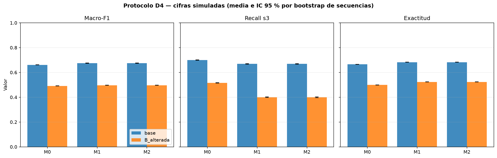

# Comparación de decodificación con modelos ocultos de Markov en un caso didáctico de riesgo de incendio forestal: anteproyecto reproducible

**Etiqueta del entregable:** anteproyecto  
**Autores:** Oscar Alonso De la Pava Suarez, Anderson Jesus Ospina Cardona, Kevin Andrés Valencia Daza  
**Grupo de trabajo:** 11  
**Docente asesor:** Julián Andrés Loaiza López (según plantilla del curso)  
**Institución:** IUDigital, Ingeniería de Software y Datos, curso de Simulación  
**Fecha:** 2026-11-09  
**Versión:** manuscrito de anteproyecto con resultados D4 y referencias verificadas  
**Declaración de uso de IA:** aprobada por el grupo de trabajo 11 el 2026-11-09

---

## Resumen

Este anteproyecto estudia, con fines exclusivamente didácticos, si la estructura temporal de un modelo oculto de Markov (HMM) aporta alguna ventaja frente a reglas simples de humedad en un caso de riesgo de incendio forestal sin datos de campo. Los estados latentes `s1`, `s2` y `s3` se tratan como etiquetas puras; la humedad se representa de forma ordinal como Alta, Media o Baja, sin porcentajes ni umbrales físicos inventados. Se fijaron las matrices A, B y π del material del caso y se compararon tres reglas de decisión con parámetros "oráculo": M0, un umbral determinista sobre la humedad actual; M1, un baseline con la ley observable exacta y prior estacionario de A; y M2, el HMM completo con A, B y π. El diseño fue pareado, con T = 500 pasos por secuencia, N = 2000 secuencias sintéticas, una semilla distinta por secuencia y agregación de métricas por secuencia mediante media, desviación estándar e intervalo de confianza del 95 % por bootstrap.

En el escenario base, la macro-F1 fue 0.6608 para M0, 0.6749 para M1 y 0.6749 para M2. En el escenario con B alterada, la macro-F1 descendió a 0.4912, 0.4966 y 0.4965, respectivamente. M1 y M2 resultaron prácticamente indistinguibles; además, M0 conservó un mayor recall de `s3` en ambos escenarios. Estas cifras son simuladas y no permiten afirmar validez ecológica, capacidad predictiva sobre incendios reales ni superioridad general del HMM. El aporte del anteproyecto es el protocolo reproducible, el código y la comparación controlada, no una conclusión aplicada.

**Palabras clave:** modelos ocultos de Markov, decodificación, Viterbi, Forward–Backward, macro-F1, simulación, reproducibilidad.

---

## 1. Introducción

### 1.1 Planteamiento del problema y justificación

El material del caso describe un entorno forestal en el que se registran niveles ordinales de humedad —Alta, Media y Baja— y se plantea explorar si un HMM permite inferir estados supuestos de riesgo: Riesgo Bajo, Riesgo Moderado y Riesgo Extremo. No se aporta un conjunto de datos sensorizados reales y se advierte que la humedad por sí sola no demuestra el nivel de riesgo en el terreno. Por tanto, el problema es didáctico y computacional: formalizar un HMM, distinguir la inferencia de estados latentes del entrenamiento de parámetros y evaluar de forma controlada distintas reglas de decodificación.

La justificación del ejercicio es metodológica. Un HMM puede parecer atractivo porque incorpora persistencia temporal, pero esa ventaja no debe presuponerse. Si no se compara contra alternativas simples y no se reporta incertidumbre, el uso del modelo puede confundirse con una preferencia técnica. Este anteproyecto adopta la opción honesta: los estados son regímenes latentes asociados a humedad y la palabra "riesgo" funciona como etiqueta didáctica, no como una variable física medida.

### 1.2 Preguntas de investigación

- **P1.** ¿Cómo formalizar un HMM de tres estados y tres observaciones ordinales de humedad sin introducir umbrales físicos ni datos no disponibles?
- **P2.** Con A, B y π fijos, ¿cómo se comparan M0, M1 y M2 en macro-F1, recall de `s3` y exactitud sobre secuencias sintéticas pareadas?
- **P3.** ¿Cómo cambia esa comparación cuando se altera la matriz de emisión B para reducir la separabilidad entre estados?

### 1.3 Objetivos y aportes

**Objetivo general:** formular, implementar y evaluar de forma reproducible una comparación de decodificación con un HMM didáctico de tres estados, sin afirmar validez ecológica.

**Objetivos específicos:**

1. Formalizar el HMM con estados `s1`, `s2`, `s3`, observaciones ordinales Alta/Media/Baja y parámetros A, B y π fijos.
2. Implementar y comparar M0, M1 y M2 en un diseño pareado con T = 500 y N = 2000, reportando macro-F1, recall de `s3` y exactitud por secuencia.
3. Evaluar un escenario secundario con B alterada y documentar sus límites.

**Aportes del anteproyecto:**

- Un protocolo explícito con parámetros, semillas, métricas y criterios de agregación.
- Código reproducible con pruebas automatizadas y artefactos trazables.
- Una comparación que separa la estructura del modelo de la calidad de estimación, porque los tres modelos reciben parámetros "oráculo".
- Una lista explícita de limitaciones y pendientes, sin inventar hallazgos ni referencias.

---

## 2. Estado del arte

### 2.1 Alcance y protocolo de la revisión

Esta revisión se realizó sobre un corpus cerrado de ocho documentos suministrados en `docs/referencias/` y dos referencias fundacionales verificadas por el equipo [1], [2]. Los criterios de inclusión fueron: (i) que el trabajo emplee un HMM o una variante declarada —HSMM o QHMM—; (ii) que describa el algoritmo de inferencia o de estimación; (iii) que reporte métricas, criterios de selección o resultados cuantitativos; y (iv) que el texto completo esté disponible. No se consultaron bases bibliográficas externas ni se aplicó un protocolo PRISMA; por tanto, el alcance es una **revisión estructurada y reproducible**, no una síntesis exhaustiva de toda la literatura. Todo metadato que no aparece explícitamente en el documento fuente se marca `[NO VERIFICADO]`.

### 2.2 Fundamentos metodológicos

Los HMM modelan una secuencia observada como la realización de una cadena de Markov latente. Rabiner [1] sistematizó los tres problemas canónicos —evaluación, decodificación y aprendizaje— y presentó Forward–Backward, Viterbi y Baum–Welch como sus soluciones algorítmicas; su artículo es una revisión metodológica con aplicaciones en reconocimiento de voz. Baum, Petrie, Soules y Weiss [2] establecieron la técnica de maximización que fundamenta la reestimación tipo EM conocida como Baum–Welch para funciones probabilísticas de cadenas de Markov. Ambos trabajos son la base del marco teórico de este anteproyecto, pero ninguno reporta una comparación empírica entre decodificación con HMM y baselines simples en un problema ordinal didáctico; su aporte es conceptual y algorítmico.

### 2.3 Aplicaciones y desarrollos recientes

**Monitorización ambiental y calidad del agua.** Wanjala, Makokha y Khamala [3] aplicaron un HMM multivariante con emisiones gaussianas a variables satelitales de aerosoles y clima en Kenia (2000–2022). Estimaron parámetros por máxima verosimilitud con EM, seleccionaron el número de estados mediante BIC y decodificaron con Viterbi. El texto de la Sección 2.6 afirma que el BIC seleccionó un modelo de tres estados, aunque el encabezado de la Tabla 1 dice “5-state model”; la discrepancia se conserva aquí como limitación de reporte del estudio. Los autores no reportan exactitud ni F1, sino BIC y correspondencia cualitativa de los meses anómalos con conteos de incendios MODIS y con el índice SPEI (Sección 2.6). Grammenos [4] modeló la ocurrencia diaria de lluvia en Ceará, Brasil, con modelos Bernoulli ocultos de primer orden, estimación EM/Baum–Welch, selección AIC/BIC y decodificación Viterbi; identificó cuatro estados ocultos sobre secuencias de 90 días en 24 años (1975–2002). Tran et al. [5] combinaron un HMM gaussiano de tres estados con una red LSTM de dos ramas y atención para clasificar la calidad de agua costera en Vietnam; usaron Baum–Welch y Viterbi para extraer estados y reportaron exactitud de 74.87 % y F1 de 64.11 %, frente a 44 % del HMM aislado, 68.2 % de la LSTM y 70.77 % de ARIMA (resumen, p. 1). El documento es un preprint de Preprints.org y declara no haber sido revisado por pares (p. 1).

**Movimiento animal, mantenimiento industrial y análisis secuencial.** Nicosia [6] propuso el “tubo de Viterbi tropical” para cuantificar la incertidumbre de trayectorias casi óptimas en lugar de devolver una única ruta. Lo aplicó a un HMM de movimiento de dos estados con longitud de paso y ángulo de giro, sobre datos GPS y acústicos de murciélagos; reportó enriquecimiento de alimentación de 2.25 (IC 95 %: 1.73–2.85) en segmentos robustos de forrajeo y de 0.27 (0.16–0.44) en desplazamiento (resumen, p. 1; Sección 7.2). Liu et al. [7] propusieron un HSMM modificado con optimización co-evolutiva para pronóstico de vida útil remanente de motores de turbofán; en la Tabla 4 (p. 35) reportan RMSE de 12.77 y Score de 259 en el Dataset#1, y RMSE de 12.59 y Score de 472 en el Dataset#3. El año de publicación y el DOI de este preprint de SSRN no aparecen en el documento y se marcan `[NO VERIFICADO]`. Deb, Pandey y Pakray [8] construyeron un QHMM que codifica emisiones en estados cuánticos y convierte matrices de transición en operadores mediante Gram–Schmidt; lo evaluaron en etiquetado gramatical (POS tagging) con corpus reales en inglés y código mixto inglés–hindi. El HMM clásico con Viterbi alcanzó 58.96 % de exactitud y el QHMM obtuvo mayor F1 en muchas etiquetas, aunque no en todas (Sección 6.5).

**Robustez estadística y reproducibilidad.** Pouzo, Psaradakis y Sola [9] analizaron la robustez de la estimación por cuasi-máxima verosimilitud (QML) cuando el proceso generador tiene regímenes HMM con transiciones dependientes de covariables, pero se estima una mixtura con regímenes i.i.d. Demostraron consistencia de los parámetros de la ecuación de resultado bajo condiciones de regularidad y evaluaron el sesgo mediante un estudio Monte Carlo con 1,000 muestras y tamaños T ∈ {200, 800, 1,600, 3,200} (Sección 3). Shevtsov [10] implementó un HMM discreto didáctico con Forward, Viterbi y Baum–Welch en espacio logarítmico, comparó su implementación con `hmmlearn` y cuantificó el error de reconstrucción de π, A y B con la norma de Frobenius, variando topologías, inicializaciones, 3/6/10 estados y 30 réplicas independientes (Secciones 4.2–4.3 y 5). Su enfoque es el más cercano al propósito reproducible de este anteproyecto, pero se centra en el **aprendizaje** de parámetros con datos simulados, no en comparar reglas de decodificación con parámetros fijos.

### 2.4 Síntesis comparativa

La Tabla 1 resume los diez trabajos. Las columnas “Tipo de HMM” e “Inferencia” describen lo declarado por cada fuente; “Datos” distingue simulación de datos reales; “Evidencia” indica la página o sección exacta que respalda la caracterización.

**Tabla 1. Comparación de trabajos previos sobre HMM y variantes.**

| Ref. | Año | Base / revista | DOI | Dominio | Tipo de HMM | Inferencia | Métricas | Datos | Evidencia |
|---|---|---|---|---|---|---|---|---|---|
| [1] | 1989 | *Proceedings of the IEEE* 77(2) | `[NO VERIFICADO]` | Voz / ASR | Discreto (multinomial) | Forward–Backward, Viterbi, Baum–Welch | Revisión metodológica; sin métricas empíricas propias | No aplica | pp. 257–286 |
| [2] | 1970 | *The Annals of Mathematical Statistics* 41(1) | `[NO VERIFICADO]` | Teoría estadística | Discreto (funciones probabilísticas de cadenas de Markov) | EM / Baum–Welch | Demostración de convergencia; sin métricas de clasificación | Simulados / teoría | pp. 164–171 |
| [3] | 2025 | *Open Access Library Journal* 12, e14160 | 10.4236/oalib.1114160 | Aerosoles y clima (Kenia) | Continuo (gaussiano multivariante) | EM, BIC, Viterbi | BIC; validación con MODIS y SPEI | Reales (satélite, 2000–2022) | Sec. 2.5–2.7; Tabla 1 |
| [4] | 2025 | Tesis MSc, AUEB (Grecia) | 10.26219/heal.aueb.9331 | Ocurrencia de lluvia (Ceará, Brasil) | Discreto (Bernoulli binario) | EM / Baum–Welch, AIC/BIC, Viterbi | AIC/BIC; 4 estados | Reales (binarios, 1975–2002) | Resumen p. 7; Sec. 2.3, 2.4.1, 2.7, 4.3–4.5 |
| [5] | 2026 | Preprints.org (no revisado por pares) | 10.20944/preprints202605.1728.v1 | Calidad de agua costera (Vietnam) | Continuo (gaussiano, 3 estados) | Baum–Welch, Viterbi, LSTM con atención | Exactitud 74.87 %; F1 64.11 %; HMM 44 % | Reales (1,305 registros) | Resumen p. 1; Sec. 2.2.1, 2.3, 3 |
| [6] | 2026 | arXiv 2606.17181v1 (enviado a *AoAS*) | `[NO VERIFICADO]` | Movimiento animal (murciélagos) | Continuo (longitud de paso y ángulo) | Viterbi + tubo tropical de trayectorias casi óptimas | Enriquecimiento 2.25 (1.73–2.85) y 0.27 (0.16–0.44) | Reales (GPS + acústico) | Resumen p. 1; Sec. 6–7.2; Tabla 5 |
| [7] | `[NO VERIFICADO]` | SSRN preprint 4156120 | `[NO VERIFICADO]` | PHM de turbofán | Continuo (HSMM; duraciones Weibull) | Forward–Backward, AGA, Weibull | RMSE 12.77/12.59; Score 259/472 | Reales (C-MAPSS) | Sec. 5; Tabla 4, p. 35 |
| [8] | 2026 | *Evolutionary Intelligence* 19:90 | 10.1007/s12065-026-01205-3 | POS tagging (inglés y código mixto) | Discreto (QHMM) | QHMM con medición cuántica; HMM + Viterbi como base | Exactitud, precisión, recall, F1; HMM clásico 58.96 % | Reales (PTB, Brown, Conll2000, code-mixed) | Resumen p. 1; Sec. 5.1–5.2, 6.1, 6.5 |
| [9] | 2025 | *Econometric Theory* 41 | 10.1017/S0266466625100017 | Econometría / regímenes | Continuo (mixtura gaussiana) | QML; Monte Carlo | Sesgo y razón desviación estándar / error estándar | Simulados (1,000 réplicas) | Resumen p. 1; Sec. 2.2, 3 |
| [10] | 2025 | Tesis de grado, Universidad de Zagreb | No reportado; URN `urn:nbn:hr:168:443559` | Didáctica / simulación | Discreto | Forward, Viterbi, Baum–Welch | Norma de Frobenius, distancia de Hamming, log-verosimilitud | Simulados | Sec. 4.2–4.3, 5.1, 5.3 |

Tres patrones emergen de la tabla. Primero, la mayoría de los trabajos aplicados **entrena** los parámetros con EM/Baum–Welch y usa el HMM como componente de un sistema mayor; la decodificación con parámetros fijos rara vez se evalúa de forma aislada. Segundo, las métricas son heterogéneas —BIC, exactitud/F1, RMSE/Score, enriquecimiento— y pocas veces se reporta la distribución completa de los resultados por réplica. Tercero, solo [6], [9] y [10] problematizan explícitamente la incertidumbre, la robustez o la reproducibilidad del algoritmo; ninguno compara la decodificación HMM contra baselines simples en un escenario ordinal con secuencias pareadas.

### 2.5 Vacío identificado y justificación de D5a

La literatura revisada muestra que los HMM se aplican con éxito en dominios diversos, pero deja abierto un problema metodológico acotado: **no hay evidencia controlada sobre si la estructura temporal de un HMM, con A, B y π fijos, mejora la decodificación frente a reglas simples cuando las observaciones son ordinales y el número de estados es pequeño**. Los estudios aplicados confunden el efecto de la estructura del modelo con el de la estimación de parámetros, porque entrenan y evalúan sobre los mismos datos o sobre datos reales sin un contraste pareado contra baselines. Los estudios metodológicos —tubos de Viterbi [6], robustez QML [9] y validación de implementaciones [10]— tampoco abordan esa comparación.

Ese es el vacío que justifica **D5a: inferencia con A, B y π fijos**. El anteproyecto aísla la decodificación del aprendizaje, usa secuencias sintéticas pareadas, compara M0 (umbral determinista), M1 (baseline observable con prior estacionario) y M2 (HMM completo), y reporta macro-F1, recall de `s3` y exactitud con media, desviación estándar, mínimo, máximo, mediana, RIC e IC 95 %, además de pruebas pareadas con corrección de Holm–Bonferroni y Delta de Cliff. El objetivo no es afirmar superioridad ecológica ni predictiva, sino determinar si, en un caso didáctico controlado, la estructura temporal aporta una ventaja medible sobre alternativas simples. La comparación es deliberadamente conservadora: si el HMM no supera a M0 y M1, no hay razón para atribuirle una ventaja aplicada.

---

## 3. Marco teórico

### 3.1 Definición del HMM

Un HMM discreto se especifica mediante \(\lambda = (S, V, A, B, \pi)\), donde:

- \(S = \{s_1, s_2, s_3\}\) es el conjunto de estados latentes, tratados como etiquetas puras.
- \(V = \{\text{Alta}, \text{Media}, \text{Baja}\}\) es el alfabeto ordinal de observaciones de humedad.
- \(A = [a_{ij}]\) es la matriz de transición, con \(a_{ij} = P(S_t = s_j \mid S_{t-1} = s_i)\) y filas que suman 1.
- \(B = [b_{i}(k)]\) es la matriz de emisión, con \(b_i(k) = P(O_t = v_k \mid S_t = s_i)\) y filas que suman 1.
- \(\pi = [\pi_i]\) es la distribución inicial en \(t = 1\), con \(\pi_i = P(S_1 = s_i)\) y suma 1.

Las matrices usadas son las del material del caso:

\[
A =
\begin{bmatrix}
0.70 & 0.25 & 0.05\\
0.30 & 0.50 & 0.20\\
0.10 & 0.30 & 0.60
\end{bmatrix},
\quad
B =
\begin{bmatrix}
0.70 & 0.25 & 0.05\\
0.20 & 0.60 & 0.20\\
0.05 & 0.25 & 0.70
\end{bmatrix},
\quad
\pi = [0.50, 0.30, 0.20].
\]

### 3.2 Supuestos y decisiones de interpretación

- **Estados como etiquetas puras (D3.1):** `s1`, `s2` y `s3` no tienen una definición física. "Riesgo Bajo", "Riesgo Moderado" y "Riesgo Extremo" son alias mnemónicos.
- **Humedad ordinal (D3.2):** Alta > Media > Baja. No se usan porcentajes ni umbrales numéricos.
- **Paso de observación (D3.3):** un paso es una ocasión de observación, sin unidad física. "Día" solo se usa como convención editorial.
- **π como prior inicial (D3.5):** π no es la distribución estacionaria de A. La estacionaria calculada es aproximadamente \([0.424, 0.348, 0.227]\), distinta de π.
- **Persistencia:** la duración media en cada estado es aproximadamente 3.3, 2.0 y 2.5 pasos.
- **Supuesto de B:** más humedad se asocia a menos riesgo en la matriz del material. Es un supuesto didáctico, no evidencia de campo.

### 3.3 Los tres problemas clásicos y el alcance de este anteproyecto

1. **Evaluación:** calcular \(P(O_{1:T} \mid \lambda)\) con Forward.
2. **Decodificación:** obtener la ruta más probable con Viterbi o las posteriores marginales con Forward–Backward.
3. **Aprendizaje:** estimar A, B y π con Baum-Welch.

Este anteproyecto se limita a **D5a: inferencia con A, B y π fijos**. Implementa Forward, Forward–Backward y Viterbi. **No implementa Baum-Welch**; el entrenamiento queda fuera del núcleo y solo podría añadirse como anexo D5b con partición por secuencia, inicializaciones múltiples, alineación de estados y control de convergencia.

### 3.4 Modelos comparados

- **M0 — umbral determinista:** asigna a cada observación el estado con mayor probabilidad en B. Con las matrices del caso: Alta → `s1`, Media → `s2`, Baja → `s3`. Solo usa la humedad actual.
- **M1 — baseline observable con prior estacionario:** usa A, B y la distribución estacionaria \(\xi\) de A en lugar de π. La ley observable exacta se deriva como \(p_O = \xi B\) y \(Q = P(S \mid O)^\top (A B)\). Esta es la forma no degenerada de explotar la estructura observable sin usar las etiquetas latentes. En este caso el mapeo M0 es biyectivo, por lo que M1 y M2 comparten A y B y difieren en el prior inicial.
- **M2 — HMM completo:** usa A, B y π. La regla primaria es el argmax de la posterior marginal de Forward–Backward; Viterbi queda disponible como análisis de sensibilidad.

### 3.5 Métricas

- **Macro-F1:** promedio no ponderado del F1 de las tres clases. Es la métrica principal porque no deja que la clase mayoritaria domine el resultado.
- **Recall de `s3`:** proporción de pasos con estado verdadero `s3` que fueron identificados como `s3`. Es secundaria y relevante porque `s3` es la clase extrema.
- **Exactitud:** proporción de pasos correctamente clasificados. Es secundaria y puede ocultar desbalances.

Las métricas se calculan por secuencia y luego se agregan. La unidad independiente es la secuencia, no el paso de tiempo.

---

## 4. Metodología

### 4.1 Diseño experimental

- **Diseño pareado:** las tres variantes reciben exactamente las mismas observaciones y se comparan contra los mismos estados latentes.
- **Tamaño:** T = 500 pasos por secuencia; N = 2000 secuencias.
- **Semillas:** una semilla maestra (`20261109`) y una semilla distinta por secuencia, derivada y registrada. No se reinicia la misma semilla en réplicas supuestamente independientes.
- **Agregación:** media, desviación estándar e intervalo de confianza del 95 % por bootstrap de secuencias (1000 réplicas).
- **Escenarios:** base y B alterada. Ambos comparten T, N, semilla maestra y regla de decisión.

### 4.2 Generación de datos

Para cada secuencia se simulan estados latentes a partir de π y A, y observaciones a partir de B. No se usan datos reales ni se ajustan parámetros con las etiquetas verdaderas. Los estados verdaderos se usan solo para evaluar, nunca para elegir el modelo ni para inicializar M1 o M2.

### 4.3 Reglas de decisión

- **M0:** \(\hat{s}_t = \arg\max_i B_{i,O_t}\).
- **M1:** HMM con A, B y \(\xi\); \(\hat{s}_t = \arg\max_i P(S_t = s_i \mid O_{1:T})\).
- **M2:** HMM con A, B y π; misma regla de posterior marginal. La ruta de Viterbi se conserva como sensibilidad.

### 4.4 Escenario con B alterada

La B alterada se construye mezclando cada fila de B con la distribución uniforme:

\[
B_{\text{alt}} = (1 - m)B + m\,\mathbf{1}/3,
\]

con \(m = 0.5\) **provisional**. Al aumentar \(m\), las emisiones se vuelven menos separables y el problema de decodificación se dificulta. El valor de \(m\) no está aprobado como decisión científica y debe fijarse antes de reportar el escenario como definitivo.

### 4.5 Reproducibilidad

La ejecución completa se realizó con:

```powershell
python main.py --save outputs/protocolo_d4_resumen.json
```

Los artefactos son:

- `outputs/protocolo_d4_resumen.json`: resumen estructurado, semillas y matrices.
- `outputs/protocolo_d4_resumen.csv`: tabla larga con media, desviación e IC.
- `outputs/protocolo_d4_resumen.md`: tablas legibles.
- `outputs/protocolo_d4_metricas.png`: figura de métricas.
- `outputs/protocolo_d4_ejecucion.log`: salida de consola.

Las tablas y la figura se regeneran con `python scripts/report_d4.py`. Las pruebas se ejecutan con `python -m pytest -q`.

### 4.6 Fases metodológicas

| Fase | Actividad | Evidencia |
|---|---|---|
| F1 | Protocolo y alcance | `decisiones.md`, D1–D6 |
| F2 | Materiales del caso | `materiales/caso_riesgo_de_incendio_forestal.md` |
| F3 | Formalización del HMM | `src/hmm_model.py`; sección 3 |
| F4 | Implementación y pruebas | `src/simulation.py`; `tests/test_protocol.py` |
| F5 | Simulación pareada | `outputs/protocolo_d4_resumen.json` |
| F6 | Métricas e intervalos | `outputs/protocolo_d4_resumen.csv` |
| F7 | Manuscrito de anteproyecto | este documento |

---

## 5. Resultados

Todas las cifras provienen de la ejecución del 2026-11-09 con T = 500, N = 2000 y semilla maestra 20261109. Son **simuladas**. Los intervalos son IC 95 % por bootstrap de secuencias.

### 5.1 Escenario base

| Modelo | Macro-F1 (media [IC 95 %]) | Recall s3 | Exactitud |
|---|---:|---:|---:|
| M0 | 0.6608 [0.6599, 0.6618] | 0.6996 [0.6976, 0.7015] | 0.6650 [0.6641, 0.6660] |
| M1 | 0.6749 [0.6738, 0.6760] | 0.6691 [0.6667, 0.6714] | 0.6828 [0.6817, 0.6838] |
| M2 | 0.6749 [0.6738, 0.6759] | 0.6691 [0.6666, 0.6715] | 0.6828 [0.6818, 0.6839] |

### 5.2 Escenario con B alterada

| Modelo | Macro-F1 (media [IC 95 %]) | Recall s3 | Exactitud |
|---|---:|---:|---:|
| M0 | 0.4912 [0.4902, 0.4922] | 0.5163 [0.5142, 0.5184] | 0.4991 [0.4982, 0.5001] |
| M1 | 0.4966 [0.4953, 0.4979] | 0.3999 [0.3970, 0.4029] | 0.5236 [0.5223, 0.5248] |
| M2 | 0.4965 [0.4952, 0.4977] | 0.3996 [0.3968, 0.4025] | 0.5236 [0.5224, 0.5248] |

### 5.3 Figura de métricas



**Figura 1.** Macro-F1, recall de `s3` y exactitud por modelo, con IC 95 % por bootstrap de secuencias. Cifras simuladas.

### 5.4 Observaciones descriptivas

- En el escenario base, M1 y M2 superan a M0 en macro-F1 y exactitud, pero M0 tiene mayor recall de `s3`.
- M1 y M2 son prácticamente indistinguibles: en el escenario base coinciden hasta la cuarta cifra decimal; con B alterada difieren en menos de \(7 \times 10^{-5}\) en macro-F1. Esto es consistente con que solo cambia el prior inicial y T es largo.
- Con B alterada, las tres variantes caen de forma marcada. M1 y M2 mejoran apenas la macro-F1 y la exactitud de M0, pero pierden aproximadamente 12 puntos porcentuales de recall de `s3`.
- No se realizaron pruebas de hipótesis formales. Los IC son descriptivos y no deben interpretarse como una prueba de superioridad.

---

## 6. Discusión

El resultado central es sobrio: en este caso didáctico, la estructura temporal del HMM mejora la macro-F1 y la exactitud frente al umbral determinista, pero no mejora el recall de la clase extrema. Además, M1 y M2 producen resultados casi idénticos, lo que sugiere que, con T = 500, el efecto del prior inicial es despreciable frente al efecto de A y B. Esto no demuestra que el HMM sea superior; muestra que la comparación depende de la métrica y del escenario.

La diferencia entre M1 y M2 es pequeña por construcción: ambos usan A y B, y solo difieren en π frente a la estacionaria ξ. Si se quisiera una línea base más exigente, habría que definir otra forma de M1; sin embargo, esa modificación no se hizo en este anteproyecto y queda como decisión pendiente para un trabajo futuro. La B alterada reduce la separabilidad de las emisiones y hace que las tres variantes se acerquen; al mismo tiempo, M1 y M2 pierden recall de `s3`. Es un recordatorio de que una mejora agregada puede ocultar un deterioro en la clase de mayor interés.

El alcance es limitado. Los estados son etiquetas puras, la humedad es ordinal, los parámetros son hipotéticos y los datos son simulados. No se contrasta con literatura porque la revisión sistemática está pendiente. Tampoco se afirma que estos resultados se generalicen a incendios reales.

---

## 7. Conclusiones

**Respuesta a P1.** El HMM puede formalizarse de manera completa con \(S = \{s_1,s_2,s_3\}\), \(V = \{\text{Alta},\text{Media},\text{Baja}\}\), A, B y π, sin inventar porcentajes de humedad ni definiciones físicas para los estados. La formalización es suficiente para implementar Forward, Forward–Backward y Viterbi.

**Respuesta a P2.** Con A, B y π fijos, en el escenario base M1 y M2 obtuvieron macro-F1 ≈ 0.6749 y exactitud ≈ 0.6828, frente a 0.6608 y 0.6650 de M0. Sin embargo, M0 obtuvo mayor recall de `s3` (0.6996 frente a 0.6691). La conclusión depende de la métrica y no autoriza a afirmar superioridad general.

**Respuesta a P3.** Con B alterada, las tres variantes cayeron a macro-F1 ≈ 0.49. M1 y M2 apenas superaron a M0 en macro-F1 y exactitud, pero perdieron recall de `s3`. El escenario es sensible a la matriz de emisión y su valor de mezcla sigue siendo provisional.

**Trabajo futuro:** activar D5b con Baum-Welch y partición por secuencia; definir una M1 alternativa si el equipo lo considera necesario; fijar el valor de B alterada; añadir pruebas de hipótesis y tamaños de efecto; completar la revisión de literatura; y, solo si se obtienen datos adecuados, explorar una validación externa.

---

## Limitaciones

- Los resultados son simulados y no tienen validez ecológica.
- Los estados `s1`, `s2`, `s3` son etiquetas puras; "riesgo" es un alias didáctico.
- La humedad es ordinal; no se usan porcentajes ni umbrales físicos.
- Los parámetros A, B y π son hipotéticos y fijos; no se estimaron de datos reales.
- M1 y M2 comparten A y B; la comparación no aísla una línea base completamente distinta.
- La B alterada usa una mezcla provisional de 0.5 con la uniforme.
- No se realizaron pruebas de hipótesis formales; los IC son descriptivos.
- La revisión sistemática de literatura sigue pendiente; las referencias incluidas fueron verificadas por el equipo.
- El manuscrito se entrega en Markdown, LaTeX y PDF; el PDF se compiló con Tectonic 0.17.0.

## Declaración de uso de IA

Se utilizó un asistente de programación basado en IA (OpenCode) para apoyar la organización del protocolo, la implementación del código, la generación de tablas y la redacción del manuscrito. Las decisiones científicas registradas en `decisiones.md` fueron expresadas por el grupo de trabajo 11. Las cifras reportadas provienen de código ejecutado y son simuladas. **Declaración aprobada por el grupo de trabajo 11 el 2026-11-09.**

## Referencias

[1] L. R. Rabiner, "A tutorial on hidden Markov models and selected applications in speech recognition," *Proceedings of the IEEE*, vol. 77, no. 2, pp. 257–286, Feb. 1989. DOI: `[NO VERIFICADO]`.

[2] L. E. Baum, T. Petrie, G. Soules, and N. Weiss, "A maximization technique occurring in the statistical analysis of probabilistic functions of Markov chains," *The Annals of Mathematical Statistics*, vol. 41, no. 1, pp. 164–171, 1970. DOI: `[NO VERIFICADO]`.

[3] D. W. Wanjala, J. W. Makokha, and G. W. Khamala, "Anomaly detection in selected aerosol optical properties and associated climate variables using a multivariate hidden Markov model: A case study over Kenya," *Open Access Library Journal*, vol. 12, Art. no. e14160, Oct. 2025, doi: 10.4236/oalib.1114160.

[4] K. Grammenos, "Hidden Markov models and their application in modeling rainfall occurrence," M.Sc. thesis, Dept. of Statistics, Athens University of Economics and Business, Athens, Greece, Mar. 2025, doi: 10.26219/heal.aueb.9331.

[5] Ha Tran Thanh, Giang Truong Tran, Hoa Thi Tran, Ngoc Minh Nguyen, and Thu Minh Phan, "Integrating hidden Markov models and attention-based LSTM framework for regulation compliance in coastal water quality assessment: A cases study in Vietnam," Preprints.org, May 2026, doi: 10.20944/preprints202605.1728.v1.

[6] A. Nicosia, "Tropical Viterbi tubes for decoding uncertainty in hidden Markov models," arXiv:2606.17181v1 [stat.ME], Jun. 2026. DOI: `[NO VERIFICADO]`.

[7] W. Liu, Q. Liu, Z. Li, M. Dong, and Y. Zheng, "Prognosis and health management of equipment based on modified hidden semi-Markov model with a co-evolutional optimization method," SSRN preprint 4156120, s. f. Año y DOI: `[NO VERIFICADO]`.

[8] B. Deb, S. Pandey, and P. Pakray, "Quantum hidden Markov model for sequential analysis," *Evolutionary Intelligence*, vol. 19, Art. no. 90, 2026, doi: 10.1007/s12065-026-01205-3.

[9] D. Pouzo, Z. Psaradakis, and M. Sola, "On the robustness of mixture models in the presence of hidden Markov regimes with covariate-dependent transition probabilities," *Econometric Theory*, vol. 41, pp. 1229–1243, 2025, doi: 10.1017/S0266466625100017.

[10] E. Shevtsov, "Hidden Markov models. Simulation, learning and evaluation," Bachelor thesis No. 12, Faculty of Electrical Engineering and Computing, University of Zagreb, Zagreb, Croatia, Jun. 2025. [Online]. Available: https://urn.nsk.hr/urn:nbn:hr:168:443559

**Materiales internos del curso (no son literatura científica):**

[11] Caso didáctico "Evaluación de riesgo de incendio forestal", `materiales/caso_riesgo_de_incendio_forestal.md`. Documento interno, no publicado.

[12] Plantilla de artículo Q1 proporcionada en el curso, `materiales/plantilla_articulo.pdf`. Documento interno, no publicado.

**Nota de verificación:** los DOI marcados `[NO VERIFICADO]` no aparecen explícitamente en el corpus suministrado. El año y el DOI de [7] tampoco están declarados en el PDF de SSRN. No se completaron por inferencia.

---

## Anexo A. Reproducibilidad

```powershell
# Entorno
python -m venv .venv
.\.venv\Scripts\Activate.ps1
pip install -r requirements.txt

# Pruebas
python -m pytest -q

# Ejecución completa D4
python main.py --save outputs/protocolo_d4_resumen.json

# Tablas y figura
python scripts/report_d4.py --input outputs/protocolo_d4_resumen.json
```

Estructura relevante:

```text
main.py                         # ejecutor del protocolo
src/hmm_model.py                # HMM, Forward, Forward–Backward, Viterbi
src/simulation.py               # M0/M1/M2, métricas y experimento D4
tests/test_protocol.py          # pruebas del protocolo
scripts/report_d4.py            # tablas y figura desde el JSON
outputs/                        # resultados simulados
legacy/                         # simulación exploratoria anterior
decisiones.md                   # bitácora D1–D6
```

## Anexo B. Trazabilidad de decisiones

| ID | Decisión | Evidencia |
|---|---|---|
| D1 | Ejercicio didáctico, sin validez ecológica | `decisiones.md` |
| D2 | Escenarios hipotéticos; toda cifra se rotula como simulada | `decisiones.md` |
| D3.1–D3.5 | Estados como etiquetas puras; humedad ordinal; paso de observación; constructo honesto; K = 3 y π inicial | `decisiones.md` |
| D4 | M0/M1/M2, macro-F1 principal, recall `s3` y exactitud secundarias; T = 500; N = 2000; B alterada | `decisiones.md`; `outputs/protocolo_d4_resumen.json` |
| D5 | D5a: solo decodificación con A, B y π fijos | `decisiones.md`; `src/hmm_model.py` |
| D6 | Aprobador/revisor grupo 11; alcance; etiqueta anteproyecto; legado aislado | `decisiones.md`; `legacy/` |

## Anexo C. Trazabilidad de las fuentes de la Sección 2

Cada afirmación de la Sección 2 se respalda en la ubicación exacta que se indica. Las páginas corresponden al PDF suministrado en `docs/referencias/`; cuando el documento usa numeración propia de revista, se indica la sección para evitar ambigüedad.

| Fuente | Afirmación respaldada | Ubicación exacta |
|---|---|---|
| [1] Rabiner | Los tres problemas canónicos y los algoritmos Forward–Backward, Viterbi y Baum–Welch | pp. 257–286 (título, resumen y cuerpo del tutorial) |
| [2] Baum et al. | Técnica de maximización que fundamenta la reestimación EM/Baum–Welch | pp. 164–171 |
| [3] Wanjala et al. | HMM multivariante gaussiano; EM; BIC; Viterbi; tres estados | Sec. 2.5–2.6, p. 7; Sec. 2.7, p. 7 |
| [3] Wanjala et al. | Datos satelitales de AOD, SSA, AE, SAT y RR en Kenia, 2000–2022 | Sec. 2.2–2.4, pp. 5–6 |
| [3] Wanjala et al. | Validación con MODIS y SPEI; discrepancia “three-state” vs. “5-state model” | Sec. 2.6, p. 7; Tabla 1, p. 7 |
| [4] Grammenos | Cuatro estados ocultos; 90 días por temporada; 1975–2002; Ceará | Resumen, p. 7; Sec. 4.2, pp. 28–32 |
| [4] Grammenos | Baum–Welch; Viterbi; selección AIC/BIC | Sec. 2.3, p. 25; Sec. 2.4.1, p. 9; Sec. 2.7, p. 13 |
| [6] Nicosia | Tubo de Viterbi tropical y trayectorias casi óptimas | Resumen, p. 1; Sec. 3, pp. 14–17 |
| [6] Nicosia | HMM de movimiento de dos estados; GPS y grabaciones acústicas de murciélagos | Sec. 1, p. 2; Sec. 7.2, p. 24 |
| [6] Nicosia | Enriquecimiento 2.25 (1.73–2.85) y 0.27 (0.16–0.44) | Resumen, p. 1; Sec. 7.3; Tabla 5 |
| [5] Tran et al. | HMM gaussiano de tres estados; Baum–Welch; Viterbi | Sec. 2.2.1, pp. 2–3 |
| [5] Tran et al. | 1,305 registros diarios y cinco parámetros de calidad de agua | Sec. 2.1.2, p. 2 |
| [5] Tran et al. | Exactitud 74.87 %, F1 64.11 %, HMM 44 %, LSTM 68.2 %, ARIMA 70.77 % | Resumen, p. 1; Sec. 3, p. 9 |
| [7] Liu et al. | HSMM modificado con optimización co-evolutiva; datos C-MAPSS | Sec. 1–2; Sec. 5, p. 34 |
| [7] Liu et al. | RMSE 12.77/12.59 y Score 259/472 | Tabla 4, p. 35 |
| [8] Deb et al. | QHMM discreto con codificación cuántica y Gram–Schmidt | Resumen, p. 1; Sec. 4.3 |
| [8] Deb et al. | Métricas de exactitud, precisión, recall y F1; HMM clásico 58.96 % | Sec. 6.1, p. 12; Sec. 6.5, pp. 12–13 |
| [9] Pouzo et al. | Consistencia de QML bajo regímenes HMM mal especificados como mixtura | Resumen, p. 1; Sec. 2.2, p. 10 |
| [9] Pouzo et al. | Monte Carlo con 1,000 muestras y T ∈ {200, 800, 1,600, 3,200}; sesgo y razón sd/SE | Sec. 3, p. 10 |
| [10] Shevtsov | Forward, Viterbi y Baum–Welch en espacio logarítmico; comparación con `hmmlearn` | Sec. 4.1–4.2, pp. 31–35; Sec. 5.1, p. 43 |
| [10] Shevtsov | Norma de Frobenius; topologías; 3/6/10 estados; 30 réplicas | Sec. 4.1.4, p. 33; Sec. 4.2, pp. 34–35; Sec. 5.3, p. 56 |

**Discrepancias y datos ausentes.** (i) En [3], el texto de la Sección 2.6 afirma que el BIC seleccionó tres estados, mientras que el encabezado de la Tabla 1 dice “5-state model”; se reporta la discrepancia y no se elige una cifra por inferencia. (ii) En [7] no aparecen año de publicación ni DOI; ambos se marcan `[NO VERIFICADO]`. (iii) En [1], [2] y [5] el DOI no está impreso en el corpus; se marca `[NO VERIFICADO]`. (iv) En [10] no hay DOI; se usa el URN institucional verificable. (v) En [6] el PDF no explicita el año final de la serie temporal; no se completa por inferencia.
