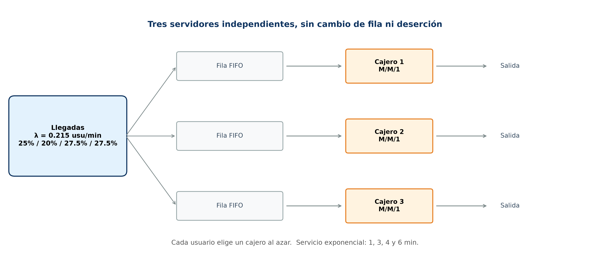
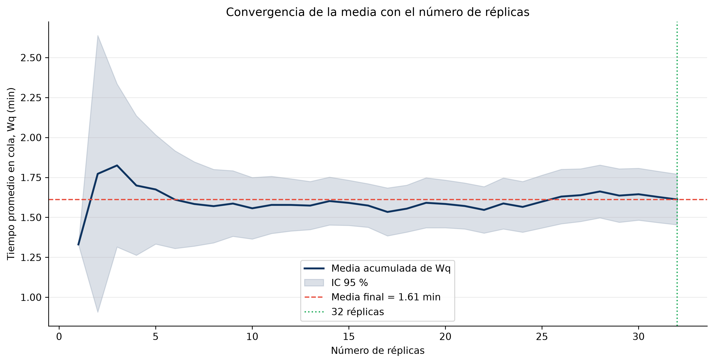
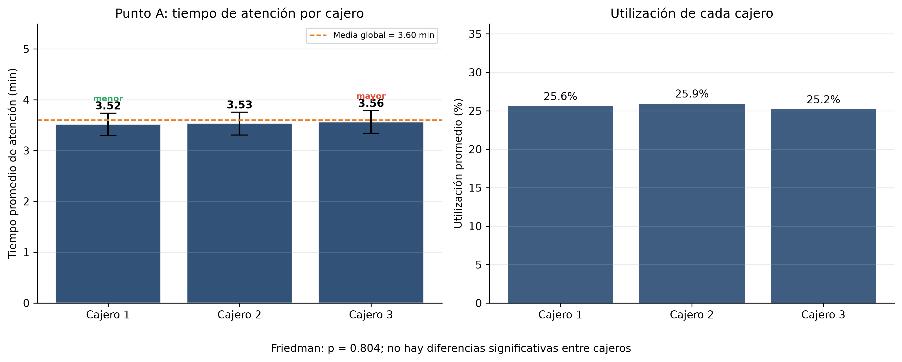
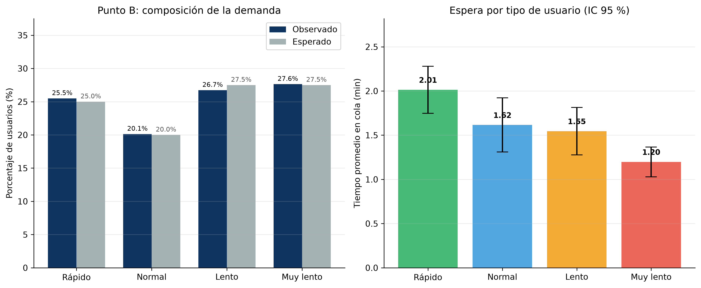
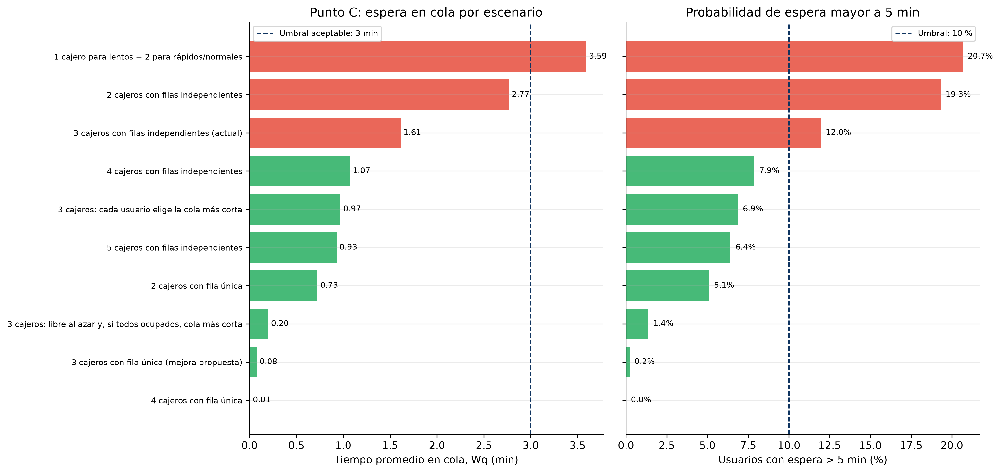
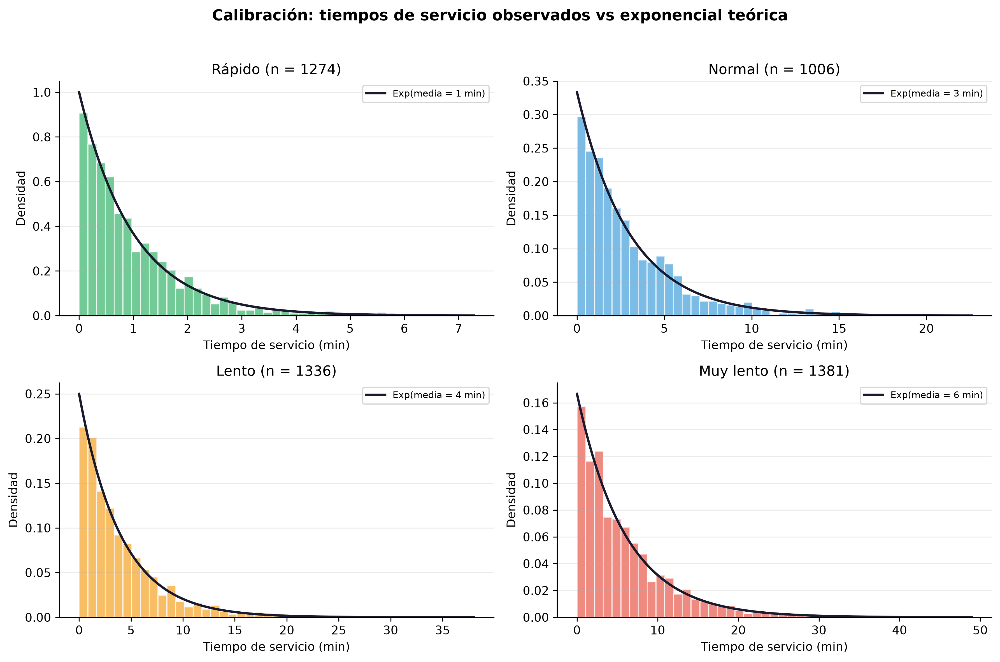
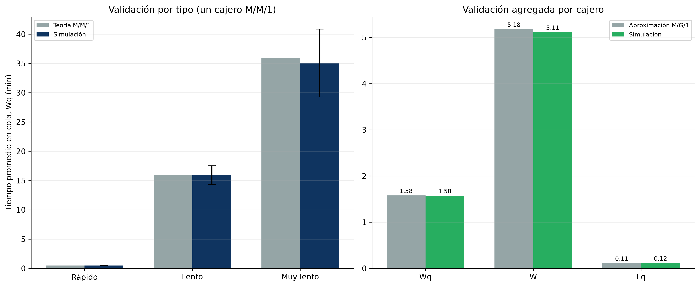
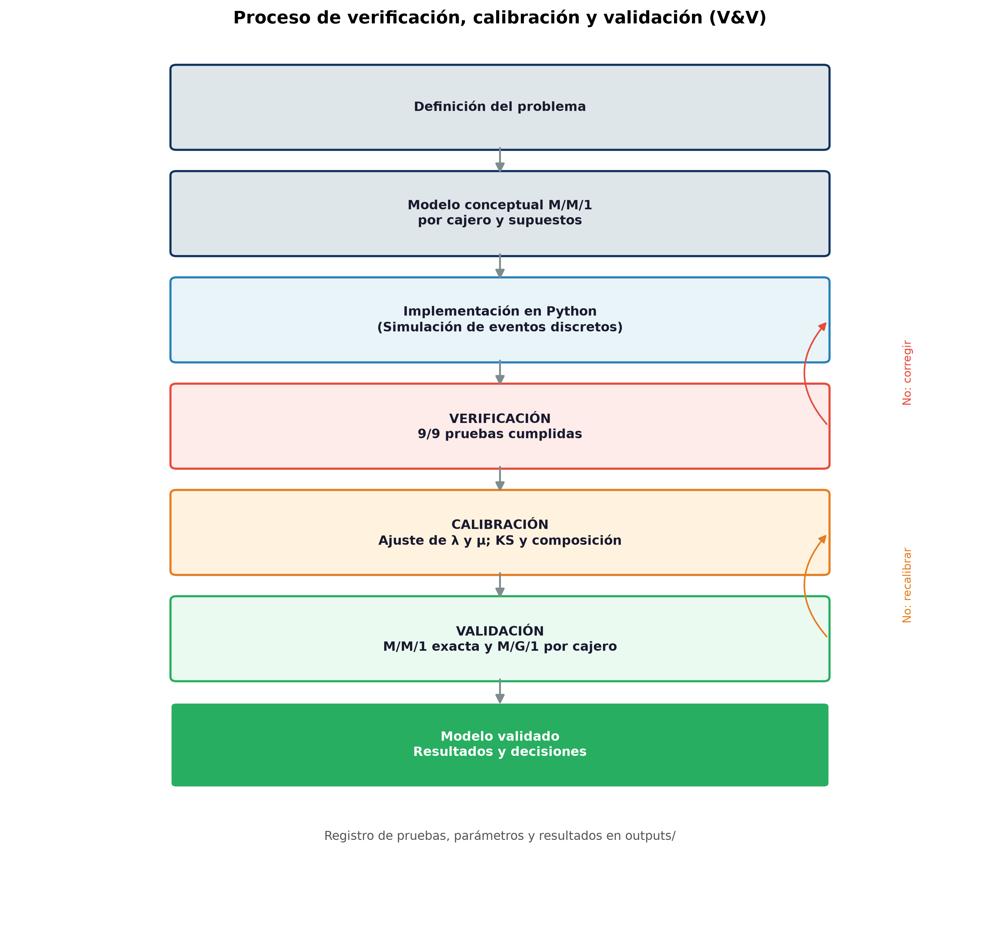
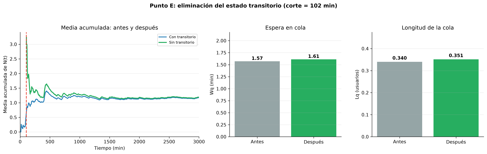
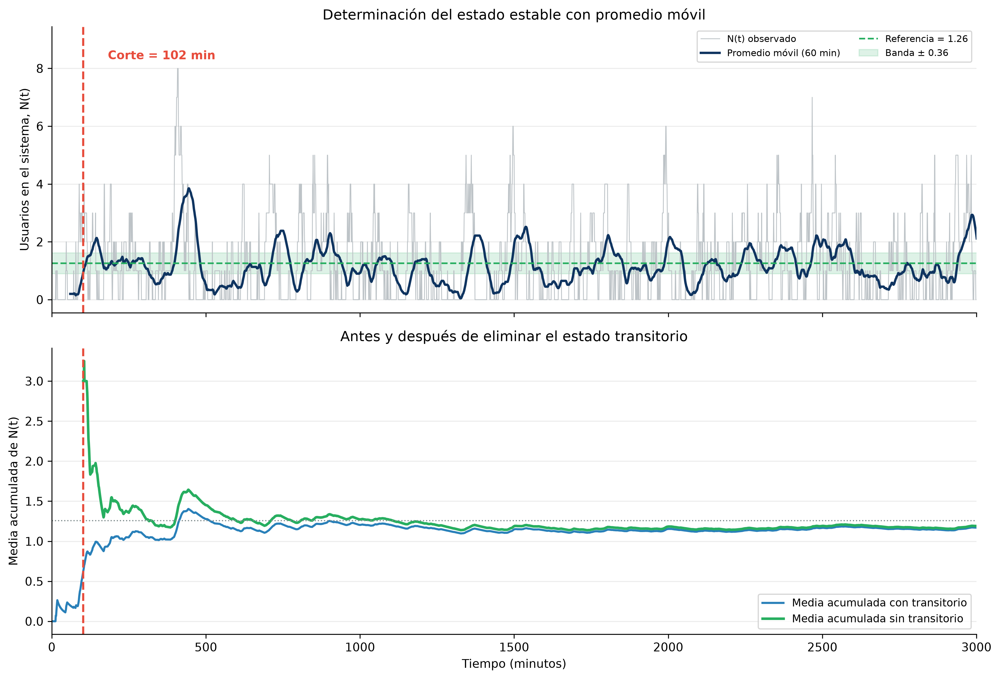

# Solución de un problema de parqueaderos mediante simulación de eventos discretos

**Institución:** Institución Universitaria Digital de Antioquia — IUDigital

**Asignatura:** Simulación

**Actividad:** AE4 — Laboratorio final

**Integrantes:**

- Oscar Alonso De la Pava Suarez
- Anderson Jesus Ospina Cardona
- Kevin Andrés Valencia Daza

**Docente:** Julián Andrés Loaiza López

**Ciudad:** Medellín, Colombia

**Fecha:** noviembre de 2026

**Versión:** 1.0

> **Nota sobre los datos.** Todas las cifras de este documento son **simuladas**.
> No provienen de registros reales del Centro Comercial Supercentro. El
> enunciado entrega las distribuciones y los parámetros; el equipo construyó el
> modelo, lo verificó, lo calibró y lo validó contra resultados analíticos.

---

## Resumen ejecutivo

El Centro Comercial Supercentro cobra el parqueadero en **tres cajeros**, cada
uno con su propia fila y sin posibilidad de cambiar de fila. El gerente debe
decidir si mantiene esa operación, agrega cajeros o reorganiza las filas. Se
construyó un simulador de eventos discretos en Python que reproduce la llegada
de cuatro tipos de usuario (rápido, normal, lento y muy lento), con tiempos
entre llegadas y de servicio exponenciales, durante una jornada de **720
minutos** (12 horas).

El experimento definitivo usó **32 réplicas**, semilla maestra **42** y
descartó los primeros **102 minutos** de cada jornada por calentamiento. Con la
configuración actual la espera promedio en cola es **1.61 min**, el tiempo en el
sistema **5.15 min**, la cola promedio **0.35 usuarios** y la utilización máxima
de un cajero **30.2 %**. El único criterio que no se cumple es la proporción de
usuarios que espera más de 5 minutos: **12.0 %** frente al máximo aceptado de
10 %.

La recomendación es **mantener los tres cajeros y cambiar la política de filas:
una sola fila compartida atendida por los tres cajeros**. Con esa configuración
la espera en cola baja a **0.08 min** (una reducción del **95 %**), el tiempo en
el sistema a **3.61 min** y la proporción de esperas mayores a 5 minutos a
**0.2 %**. No se requiere inversión en infraestructura ni personal adicional: el
cambio es organizativo. Como alternativas se evaluaron una política de “cola más
corta” (Wq = 0.97 min) y una política adaptativa (Wq = 0.20 min), ambas
compatibles con la operación actual. La validación contra la teoría M/M/1, la
aproximación M/G/1 y la fórmula de Erlang C arrojó errores inferiores al 3.5 %.

---

## 1. Introducción

### 1.1 Contexto y problema

El Centro Comercial Supercentro cobra el servicio de parqueadero en tres
cajeros ubicados en la salida. Cada cajero atiende a un usuario a la vez y tiene
su propia fila: quien llega elige una fila y no puede cambiarse. En las horas de
mayor afluencia los usuarios perciben demoras desiguales: algunas filas avanzan
y otras no, aunque los cajeros tengan velocidades de atención parecidas.

El problema que debe resolver la administración es concreto: **¿la operación
actual de tres cajeros es suficiente para ofrecer un servicio aceptable y, si no
lo es, qué cambio conviene hacer?** Las alternativas incluyen agregar cajeros,
reorganizar las filas o especializar cajeros por tipo de usuario.

Este tipo de decisión no se puede resolver con una regla de tres. La demanda es
aleatoria, los tiempos de atención también y el desempeño depende de la
interacción entre ambos. Por eso se usa **simulación de eventos discretos**: se
representa el sistema, se ejecutan muchas réplicas de una jornada y se comparan
las alternativas con criterios de servicio explícitos.

### 1.2 Objetivos

**Objetivo general.** Evaluar el desempeño del sistema de pago de parqueaderos
del Centro Comercial Supercentro y recomendar una configuración de cajeros y
filas que reduzca la espera de los usuarios con un uso eficiente de los
recursos.

**Objetivos específicos.**

1. Simular al menos 10 réplicas independientes de una jornada de 12 horas.
2. Identificar el cajero con menor y mayor tiempo promedio de atención y
   determinar si las diferencias son estadísticamente significativas.
3. Estimar el promedio de usuarios de cada tipo en el conjunto de cajeros y
   verificar que la composición de la demanda coincida con la del enunciado.
4. Comparar escenarios de capacidad y de política de filas con criterios de
   espera, cola y utilización, y sustentar una recomendación.
5. Verificar, calibrar y validar el modelo contra resultados analíticos.
6. Eliminar el estado transitorio y reportar únicamente el estado estable.

### 1.3 Alcance

El modelo representa la operación de los cajeros de salida durante una jornada
típica de 12 horas. Se incluyen:

- Cuatro tipos de usuario con probabilidades 25 %, 20 %, 27.5 % y 27.5 %.
- Tiempos entre llegadas exponenciales con media de 3, 3, 5 y 7 minutos.
- Tiempos de servicio exponenciales con media de 1, 3, 4 y 6 minutos.
- Tres cajeros (configuración base) con fila FIFO propia y sin cambio de fila.
- Políticas alternativas: fila única compartida, elección de la cola más corta,
  política adaptativa y especialización por tipo.
- Drenaje del sistema después del cierre: quien alcanzó a llegar termina su
  servicio aunque el reloj supere las 12 horas.

Quedan fuera del alcance la operación de entrada de vehículos, los medios de
pago electrónicos, la deserción de usuarios, los picos horarios explícitos, la
asignación de turnos del personal y los costos salariales detallados.

### 1.4 Justificación

La simulación permite comparar alternativas sin intervenir la operación real y
sin asumir supuestos simplificadores difíciles de sostener, como una cola única
cuando en realidad hay tres. Además, permite reportar no solo promedios sino
**probabilidades de espera**, que es lo que percibe el usuario, y cuantificar la
incertidumbre mediante intervalos de confianza.

El resultado tiene valor práctico inmediato: si la mejora se logra cambiando la
política de filas, la administración puede tomar la decisión sin comprar
equipos ni contratar personal.

---

## 2. Metodología

### 2.1 Elementos de teoría de colas y modelo M/M/1

Un sistema de colas se describe con la notación de Kendall $A/B/c/K$. En este
caso cada cajero se modela como **M/M/1**: llegadas Poisson (tiempos entre
llegadas exponenciales), servicio exponencial y un servidor. Para un M/M/1 con
tasa de llegadas $\lambda$ y tasa de servicio $\mu$:

$$
\rho = \frac{\lambda}{\mu}, \qquad
L_q = \frac{\rho^2}{1-\rho}, \qquad
W_q = \frac{\rho}{\mu-\lambda}, \qquad
W = W_q + \frac{1}{\mu}, \qquad
L = \lambda W.
$$

La **ley de Little** ($L = \lambda W$ y $L_q = \lambda W_q$) relaciona las
longitudes promedio con los tiempos promedio y se usa como verificación interna.

Cuando el servicio no es exponencial pero se conoce su segundo momento, la
**fórmula de Pollaczek-Khinchine** para M/G/1 con un servidor es:

$$
W_q = \frac{\lambda \, E[S^2]}{2(1-\rho)}.
$$

Para varios servidores con fila única, la fórmula de **Erlang C** permite
calcular la probabilidad de esperar y la espera promedio en un M/M/c. Estas dos
referencias se usan en la validación (sección 3.4).

La carga ofrecida del sistema es la suma de las cargas por tipo:

$$
a = \lambda \, E[S] = \frac{E[S]}{E[\text{tiempo entre llegadas}]}
  = \frac{3.600}{4.650} = 0.774 \text{ erlangs}.
$$

Con tres cajeros, la carga por cajero es $0.774/3 = 0.258$, muy por debajo de
1, de modo que el sistema es estable.

### 2.2 Datos del enunciado y supuestos

| Tipo de usuario | Probabilidad | Media entre llegadas (min) | Media de servicio (min) |
|---|---:|---:|---:|
| Rápido | 25.0 % | 3 | 1 |
| Normal | 20.0 % | 3 | 3 |
| Lento | 27.5 % | 5 | 4 |
| Muy lento | 27.5 % | 7 | 6 |
| **Agregado** | **100 %** | **4.650** | **3.600** |

**Supuestos del modelo.**

1. La jornada dura 720 minutos y es representativa de un día típico.
2. En cada llegada se sortea primero el tipo de usuario y luego el tiempo hasta
   la siguiente llegada con la exponencial de ese tipo. Así la composición de
   la demanda es exactamente la del enunciado.
3. Los tiempos de servicio son independientes entre sí y de la llegada.
4. Cada cajero atiende un usuario a la vez, en orden FIFO.
5. En la configuración base el usuario elige un cajero al azar y no cambia de
   fila; no hay deserción ni renegociación.
6. Los cajeros no se caen, no descansan y no cierran durante la jornada.
7. Después del minuto 720 no llegan más usuarios, pero los que ya estaban en el
   sistema terminan su servicio (drenaje).

### 2.3 Modelo de simulación

Se implementó un simulador de eventos discretos con reloj de eventos y una cola
FIFO por servidor (`src/parking_simulation.py`). El motor procesa las llegadas
en orden, libera los cajeros cuyos servicios terminan antes o en el instante de
la llegada y asigna al usuario según la política del escenario. Al finalizar las
llegadas se drena el sistema: se procesan todas las terminaciones pendientes.

Para cada usuario se registran: tipo, instante de llegada, cajero asignado,
inicio y fin de servicio, tiempo de espera, tiempo de servicio y tiempo en el
sistema. Con esos registros se calculan las métricas por jornada:

- **Por usuario:** espera media, percentiles (P50, P90, P95), máximo y
  proporción de esperas mayores a 3, 5 y 10 minutos.
- **Por sistema:** $L_q$ y $L$ como integrales temporales del número de
  usuarios en cola y en el sistema divididas por la ventana de observación,
  utilización por cajero (tiempo ocupado / ventana) y throughput.
- **Por cajero:** atendidos, servicio medio, espera media y utilización.
- **Por tipo:** conteo, espera media y P90, servicio medio y tiempo en el
  sistema.

El uso de integrales temporales, en lugar de promedios de conteos puntuales,
evita sesgos cuando la ventana no coincide con los instantes de los eventos.



*Figura 1. Esquema del sistema modelado: tres servidores M/M/1 independientes,
sin cambio de fila ni deserción. Fuente: `outputs/figuras/fig_sistema.png`.*

### 2.4 Diseño experimental

**Números aleatorios comunes.** Dentro de cada réplica, todos los escenarios
reciben exactamente las mismas llegadas, tipos de usuario y tiempos de servicio.
Solo cambia la política de filas. Así la comparación entre escenarios es
pareada y la varianza de las diferencias se reduce.

**Semillas.** Se usa `numpy.random.SeedSequence(42)` y se generan secuencias
hijas independientes por réplica para llegadas, servicios y asignación. Esto
garantiza reproducibilidad exacta y evita correlaciones entre flujos.

**Calentamiento.** Se ejecutó una corrida piloto de 10 000 minutos y se aplicó
el método del **promedio móvil** sobre el número de usuarios en el sistema
$N(t)$, con ventana de 60 minutos. La referencia es la media de la segunda mitad
de la serie y la banda de aceptación es
$\max(0.15\,|\bar N|,\; 2s/\sqrt{60})$. El corte es el final de la primera
ventana que entra en la banda y deja una media posterior dentro de ella. El
resultado fue **102 minutos**, que se descuentan de cada jornada de 720 minutos.

**Número de réplicas.** Con 30 réplicas piloto se estimó el número necesario
para que el intervalo de confianza del 95 % de la espera media tuviera un error
relativo máximo del 10 %. La fórmula iterativa
$n = \lceil (t_{n-1}\,s / (e\,\bar x))^2 \rceil$ arrojó **32 réplicas**, que se
usaron en el experimento definitivo. La figura 2 muestra la convergencia.



*Figura 2. Media acumulada de la espera en cola e intervalo de confianza del
95 % según el número de réplicas. Fuente: `outputs/figuras/fig_replicas_convergencia.png`.*

### 2.5 Escenarios evaluados

| Clave | Escenario | Cajeros | Política de filas |
|---|---|---:|---|
| `indep_2` | 2 cajeros, filas independientes | 2 | Elección aleatoria |
| `indep_3` | **Configuración actual** | 3 | Elección aleatoria |
| `indep_3_corta` | 3 cajeros, cola más corta | 3 | Cola más corta al llegar |
| `indep_3_adaptativa` | 3 cajeros, política adaptativa | 3 | Libre al azar; si todos ocupados, cola más corta |
| `indep_4` | 4 cajeros, filas independientes | 4 | Elección aleatoria |
| `indep_5` | 5 cajeros, filas independientes | 5 | Elección aleatoria |
| `unica_2` | 2 cajeros, fila única | 2 | Fila compartida FIFO |
| `unica_3` | **Mejora propuesta**: 3 cajeros, fila única | 3 | Fila compartida FIFO |
| `unica_4` | 4 cajeros, fila única | 4 | Fila compartida FIFO |
| `especializado_3` | 1 cajero para lentos + 2 para rápidos/normales | 3 | Filas independientes especializadas |

Los escenarios permiten separar dos efectos: el **efecto capacidad** (más
cajeros) y el **efecto política de filas** (misma capacidad, mejor asignación).

### 2.6 Criterios de decisión

Los criterios se definieron antes de ver los resultados, para evitar ajustar la
regla a la respuesta. Se toman como metas de servicio razonables para un centro
comercial y son configurables en `CRITERIA`:

| Criterio | Umbral | Justificación |
|---|---:|---|
| Espera promedio en cola, $W_q$ | ≤ 3 min | Meta de servicio al cliente |
| Espera promedio en el sistema, $W$ | ≤ 8 min | Incluye atención y espera |
| Longitud promedio de la cola, $L_q$ | ≤ 3 usuarios | Evita filas visibles largas |
| Utilización máxima de un cajero | ≤ 85 % | Deja margen ante picos |
| Proporción con espera > 5 min | ≤ 10 % | Controla la cola de la distribución, no solo el promedio |

Un escenario es **viable** si cumple los cinco criterios. Entre los viables se
prefiere el de menor espera; entre alternativas de igual desempeño, el que no
exija inversión adicional. Si la configuración actual ya cumple, no se cambia.

### 2.7 Verificación, calibración y validación

Se siguió el ciclo clásico de Banks et al.:

- **Verificación:** comprobar que el programa hace lo que se diseñó. Nueve
  pruebas automáticas sobre los datos crudos (identificadores únicos, drenaje,
  causalidad temporal, tiempos positivos, cajero válido, utilización en [0,1],
  colas no negativas, conservación de usuarios).
- **Calibración:** comparar los parámetros estimados con los nominales. Medias
  de servicio por tipo y tasa de llegadas, con prueba de Kolmogorov-Smirnov para
  el ajuste exponencial.
- **Validación:** comparar el simulador con teoría. Para cada tipo se simula un
  cajero dedicado (M/M/1 exacto) con 30 réplicas de 10 000 minutos y
  calentamiento de 2 000. Para el sistema completo se compara con la
  aproximación M/G/1 por cajero y con Erlang C para la fila única.

### 2.8 Herramientas y reproducibilidad

Python 3.12 con `numpy`, `pandas`, `scipy`, `matplotlib` y `python-docx`. Todo el
experimento se reproduce con:

```powershell
python main.py                 # piloto, réplicas y experimento -> outputs/
python scripts/build_report_assets.py   # tablas, figuras y resumen
python -m pytest -q            # pruebas automáticas
```

La semilla maestra, la duración, el calentamiento y el número de réplicas quedan
registrados en `outputs/resultados.json`, junto con la definición de cada
escenario. Las figuras se guardan a 300 dpi en `outputs/figuras/`.

---

## 3. Resultados

### 3.0 Configuración del experimento

| Parámetro | Valor |
|---|---:|
| Réplicas | 32 |
| Duración de la jornada | 720 min (12 h) |
| Calentamiento eliminado | 102 min |
| Ventana de estado estable | 618 min |
| Semilla maestra | 42 |
| Media entre llegadas | 4.650 min |
| Media de servicio | 3.600 min |
| Tasa de llegadas $\lambda$ | 0.2151 usuarios/min (12.98/h) |
| Carga ofrecida | 0.774 erlangs |
| Carga por cajero (3 cajeros) | 0.258 |

El sistema es estable y opera con holgura de capacidad: la carga por cajero es
cercana al 26 %. Esto anticipa que el problema no es la falta de capacidad sino
la **forma de asignar los usuarios a los cajeros**.

### 3.1 Punto A — Cajero con menor y mayor tiempo promedio de atención

| Cajero | Atendidos (prom.) | Servicio prom. (min) | IC 95 % | Espera prom. (min) | Utilización | Cola prom. |
|---|---:|---:|---|---:|---:|---:|
| 1 | 44.75 | **3.5168** | [3.2956, 3.7380] | 1.5721 | 25.59 % | 0.1192 |
| 2 | 45.34 | 3.5304 | [3.3036, 3.7571] | 1.6355 | 25.92 % | 0.1225 |
| 3 | 43.59 | **3.5633** | [3.3404, 3.7861] | 1.5224 | 25.17 % | 0.1097 |

- **Menor tiempo promedio de atención:** cajero 1, con 3.5168 min.
- **Mayor tiempo promedio de atención:** cajero 3, con 3.5633 min.
- **Diferencia:** 0.0465 min (2.8 segundos), es decir **1.3 %** respecto a la
  media global de 3.5368 min.

La prueba de **Friedman** para medidas repetidas (mismas 32 réplicas, tres
cajeros) dio $\chi^2 = 0.4375$ y **p = 0.804**. No hay evidencia de diferencias
significativas entre los tiempos promedio de atención. Los intervalos de
confianza se solapan ampliamente y las diferencias observadas son compatibles
con el azar del muestreo, no con cajeros “más lentos”.



*Figura 3. Punto A. Tiempo promedio de atención con IC 95 % (izquierda) y
utilización por cajero (derecha). Fuente: `outputs/figuras/fig_cajeros.png`.*

**Lectura para la decisión.** Como los cajeros atienden a velocidades
estadísticamente iguales, especializar cajeros o reassignar personal no ataca la
causa del problema. La atención es homogénea; lo que difiere es la **cola que
elige cada usuario**.

### 3.2 Punto B — Promedio de usuarios de cada tipo

Promedio por réplica en el conjunto de los tres cajeros (ventana estable de
618 min):

| Tipo | Usuarios prom. | IC 95 % | % observado | % esperado | Servicio prom. (min) | Espera prom. (min) | P90 espera (min) |
|---|---:|---|---:|---:|---:|---:|---:|
| Rápido | 39.81 | [36.97, 42.66] | 25.50 % | 25.00 % | 0.98 | 2.01 | 6.97 |
| Normal | 31.44 | [28.99, 33.88] | 20.13 % | 20.00 % | 2.97 | 1.62 | 4.94 |
| Lento | 41.75 | [39.71, 43.79] | 26.74 % | 27.50 % | 4.02 | 1.55 | 5.86 |
| Muy lento | 43.16 | [40.97, 45.34] | 27.64 % | 27.50 % | 5.85 | 1.20 | 4.03 |
| **Total** | **156.16** | — | **100 %** | **100 %** | **3.54** | **1.61** | — |

La prueba de **chi-cuadrado de bondad de ajuste** ($\chi^2 = 1.628$, 3 grados de
libertad, **p = 0.653**) confirma que la composición observada no difiere de la
esperada 25/20/27.5/27.5. La mayor desviación es de 0.5 puntos porcentuales
(muy lento: 27.64 % vs 27.50 %).



*Figura 4. Punto B. Composición observada vs esperada (izquierda) y espera
promedio por tipo con IC 95 % (derecha). Fuente: `outputs/figuras/fig_tipos.png`.*

**Hallazgo relevante.** La espera **no** crece con el tiempo de servicio: los
usuarios rápidos esperan más (2.01 min) que los muy lentos (1.20 min). La
explicación es que la mayoría de los rápidos llega en los primeros minutos de
cada intervalo y espera a que se desocupen cajeros ocupados por servicios
largos; los muy lentos, en cambio, encuentran con frecuencia un cajero libre
porque su propia llegada es menos frecuente. Es un efecto de la variabilidad y
de la política de asignación aleatoria, y refuerza la necesidad de revisar la
política de filas.

En promedio se atienden **156.2 usuarios por jornada** (≈ 13 por hora), de los
cuales 133.2 llegan dentro de la ventana estable.

### 3.3 Punto C — Estrategia de mejora

#### 3.3.1 Comparación de escenarios

Los valores son promedios de 32 réplicas sobre la ventana de estado estable.

| # | Escenario | Cajeros | $W_q$ (min) | $W$ (min) | $L_q$ | Util. máx. | P(>5 min) | ¿Cumple? |
|---:|---|---:|---:|---:|---:|---:|---:|---|
| 1 | 4 cajeros con fila única | 4 | 0.006 | 3.543 | 0.001 | 23.5 % | 0.0 % | Sí |
| 2 | **3 cajeros con fila única** | **3** | **0.077** | **3.614** | **0.017** | **29.4 %** | **0.2 %** | **Sí** |
| 3 | 3 cajeros, política adaptativa | 3 | 0.200 | 3.737 | 0.043 | 29.0 % | 1.4 % | Sí |
| 4 | 2 cajeros con fila única | 2 | 0.725 | 4.262 | 0.156 | 40.8 % | 5.1 % | Sí |
| 5 | 5 cajeros, filas independientes | 5 | 0.929 | 4.467 | 0.201 | 20.7 % | 6.4 % | Sí |
| 6 | 3 cajeros, cola más corta | 3 | 0.970 | 4.507 | 0.208 | 29.6 % | 6.9 % | Sí |
| 7 | 4 cajeros, filas independientes | 4 | 1.070 | 4.607 | 0.235 | 24.1 % | 7.9 % | Sí |
| 8 | **3 cajeros, filas independientes (actual)** | **3** | **1.612** | **5.149** | **0.351** | **30.2 %** | **12.0 %** | **No** |
| 9 | 2 cajeros, filas independientes | 2 | 2.767 | 6.304 | 0.606 | 42.2 % | 19.3 % | No |
| 10 | 1 cajero para lentos + 2 para rápidos/normales | 3 | 3.592 | 7.129 | 0.788 | 58.6 % | 20.7 % | No |

Intervalos de confianza del 95 % para $W_q$ de los escenarios principales:

| Escenario | $W_q$ medio | IC 95 % | Amplitud relativa |
|---|---:|---|---:|
| `indep_3` (actual) | 1.612 | [1.447, 1.777] | ±10.2 % |
| `indep_3_adaptativa` | 0.200 | [0.145, 0.256] | ±27.8 % |
| `indep_3_corta` | 0.970 | [0.872, 1.068] | ±10.1 % |
| `unica_2` | 0.725 | [0.560, 0.891] | ±22.8 % |
| `unica_3` | 0.077 | [0.049, 0.105] | ±36.4 % |
| `unica_4` | 0.006 | [0.001, 0.011] | ±83.3 % |

La amplitud relativa crece cuando la espera es muy pequeña porque el error
absoluto se mantiene y la media se acerca a cero; esto no afecta la conclusión:
incluso el límite superior de `unica_3` (0.105 min) está muy por debajo del
umbral de 3 min.



*Figura 5. Punto C. Espera promedio en cola (izquierda) y proporción de esperas
mayores a 5 minutos (derecha). Verde: cumple los cinco criterios; rojo: no
cumple. Fuente: `outputs/figuras/fig_escenarios.png`.*

#### 3.3.2 Diagnóstico de la configuración actual

La configuración actual **cumple cuatro de los cinco criterios**:

| Criterio | Valor | Umbral | Estado |
|---|---:|---:|---|
| $W_q$ | 1.61 min | ≤ 3 min | Cumple |
| $W$ | 5.15 min | ≤ 8 min | Cumple |
| $L_q$ | 0.35 | ≤ 3 | Cumple |
| Utilización máxima | 30.2 % | ≤ 85 % | Cumple |
| P(espera > 5 min) | 12.0 % | ≤ 10 % | **No cumple** |

El problema no es el promedio, que es aceptable, sino la **cola de la
distribución**: uno de cada ocho usuarios espera más de cinco minutos. Esto
ocurre porque la asignación aleatoria crea desbalance: un usuario puede quedar
detrás de varios servicios largos mientras otro cajero se desocupa. La
utilización de 30 % confirma que sobra capacidad; el problema es de reparto.

#### 3.3.3 Decisión recomendada

**Recomendación: `unica_3` — mantener los tres cajeros y pasar a una fila única
compartida.**

Justificación cuantitativa:

- $W_q$: **1.612 → 0.077 min** (−95.2 %).
- $W$: **5.149 → 3.614 min** (−29.8 %).
- $L_q$: **0.351 → 0.017** (−95.2 %).
- P(espera > 5 min): **12.0 % → 0.2 %** (−98.3 %).
- Utilización máxima: 30.2 % → 29.4 % (sin cambio práctico).
- **Cajeros adicionales: 0. Inversión en equipos: 0.**

La mejora proviene de eliminar el desbalance: el siguiente usuario siempre pasa
al primer cajero que se desocupa. Es la misma capacidad instalada, mejor usada.

#### 3.3.4 Alternativas y análisis costo-beneficio

- **`unica_2` (2 cajeros, fila única):** es la opción **más económica que
  cumple** ($W_q$ = 0.725 min, P(>5) = 5.1 %, utilización 40.8 %). Si el centro
  comercial quisiera reasignar un cajero a otra función, esta configuración
  sigue siendo aceptable. No se recomienda como primera opción porque los tres
  cajeros ya existen y liberar uno no genera un ahorro inmediato comparable con
  el margen de servicio que se pierde.
- **`indep_3_adaptativa` (misma capacidad, sin fila única):** alcanza $W_q$ =
  0.200 min y P(>5) = 1.4 %. Es la mejor alternativa si por restricciones
  físicas no se puede implementar una fila única; requiere un turno o pantalla
  que indique el cajero libre.
- **`indep_3_corta` (cola más corta):** $W_q$ = 0.970 min y P(>5) = 6.9 %.
  Cumple, pero es sensible a la información que el usuario percibe: la “cola más
  corta” en número de personas no siempre es la de menor tiempo restante.
- **`indep_4` y `indep_5` (más cajeros):** cumplen, pero cuestan personal
  adicional y su desempeño es peor que `unica_3` con tres cajeros. Agregar
  capacidad sin corregir la política es una solución cara e ineficiente.
- **`unica_4`:** mejor desempeño absoluto ($W_q$ = 0.006 min), pero exige un
  cuarto cajero. No se justifica: la mejora marginal frente a `unica_3` es de
  0.07 min y el costo es un puesto de trabajo permanente.
- **`especializado_3`:** el peor escenario ($W_q$ = 3.592 min, P(>5) = 20.7 %).
  Especializar concentra a los usuarios lentos en un solo cajero y genera un
  cuello de botella; la intuición de “cada cajero para lo que es bueno” falla
  cuando la demanda es heterogénea.

**Conclusión del punto C.** La política de filas es la palanca de mejora, no la
capacidad. Con la misma infraestructura se reduce la espera en más del 95 %.

### 3.4 Punto D — Verificación, calibración y validación

#### 3.4.1 Verificación

| Prueba | Resultado |
|---|---|
| Identificadores únicos por escenario y réplica | Cumple (0 duplicados) |
| Todos los usuarios que llegan terminan su servicio | Cumple (49 970 registros) |
| El servicio nunca inicia antes de la llegada | Cumple (0 violaciones) |
| El servicio termina después de iniciar | Cumple (0 violaciones) |
| Tiempos de servicio positivos y esperas no negativas | Cumple |
| Cada usuario es atendido por un cajero válido y solo uno | Cumple |
| Utilización de cada cajero en [0, 1] | Cumple (rango [0.124, 0.486]) |
| Longitudes promedio de cola y sistema no negativas | Cumple |
| Conservación de usuarios (sin pérdidas ni duplicados) | Cumple |

Se cumplen **9 de 9** pruebas. Además, la ley de Little se satisface en los
datos: para `indep_3`, $L_q = 0.351$ y $\lambda W_q = 0.2151 \times 1.612 =
0.347$; la diferencia (1.1 %) es consistente con el redondeo y el uso de la
ventana estable.

#### 3.4.2 Calibración

| Parámetro | Nominal (min) | Estimado (min) | Error | n | KS | p valor | Ajusta |
|---|---:|---:|---:|---:|---:|---:|---|
| Servicio rápido | 1.00 | 0.9759 | −2.41 % | 1 274 | 0.0171 | 0.842 | Sí |
| Servicio normal | 3.00 | 2.9522 | −1.59 % | 1 006 | 0.0198 | 0.816 | Sí |
| Servicio lento | 4.00 | 4.0080 | +0.20 % | 1 336 | 0.0150 | 0.919 | Sí |
| Servicio muy lento | 6.00 | 5.8573 | −2.38 % | 1 381 | 0.0138 | 0.953 | Sí |

| Parámetro | Nominal | Estimado | Error | IC 95 % |
|---|---:|---:|---:|---|
| Tasa de llegadas $\lambda$ (usuarios/min) | 0.2151 | 0.2163 | +0.59 % | [0.2103, 0.2223] |

Todas las medias están dentro de ±2.5 % del valor nominal y ninguna prueba KS
rechaza la exponencial (p > 0.8). La tasa de llegadas estimada está a 0.6 % de
la nominal y el intervalo de confianza contiene el valor teórico. El generador
de números aleatorios y las distribuciones están correctamente implementados.



*Figura 6. Histogramas de tiempos de servicio observados con la densidad
exponencial teórica. Fuente: `outputs/figuras/fig_calibracion.png`.*

#### 3.4.3 Validación contra teoría M/M/1

Se simularon 30 réplicas de 10 000 minutos (calentamiento 2 000) para un cajero
dedicado a cada tipo, lo que constituye un M/M/1 exacto.

| Tipo | Métrica | Teoría | Simulación | IC 95 % | Error | p (t) |
|---|---|---:|---:|---|---:|---:|
| Rápido | $W$ | 1.500 | 1.4941 | [1.4735, 1.5147] | −0.39 % | 0.565 |
| Rápido | $W_q$ | 0.500 | 0.4948 | [0.4779, 0.5116] | −1.05 % | 0.529 |
| Rápido | $L$ | 0.500 | 0.4997 | [0.4906, 0.5088] | −0.07 % | — |
| Rápido | $L_q$ | 0.167 | 0.1655 | [0.1592, 0.1718] | −0.71 % | — |
| Lento | $W$ | 20.000 | 19.9050 | [18.2786, 21.5314] | −0.48 % | 0.906 |
| Lento | $W_q$ | 16.000 | 15.9116 | [14.3123, 17.5110] | −0.55 % | 0.911 |
| Lento | $L$ | 4.000 | 3.9796 | [3.6303, 4.3289] | −0.51 % | — |
| Lento | $L_q$ | 3.200 | 3.1833 | [2.8438, 3.5228] | −0.52 % | — |
| Muy lento | $W$ | 42.000 | 41.0427 | [35.2054, 46.8799] | −2.28 % | 0.740 |
| Muy lento | $W_q$ | 36.000 | 35.0596 | [29.2626, 40.8566] | −2.61 % | 0.742 |
| Muy lento | $L$ | 6.000 | 5.8528 | [4.9761, 6.7294] | −2.45 % | — |
| Muy lento | $L_q$ | 5.143 | 5.0053 | [4.1404, 5.8702] | −2.67 % | — |

Los errores son inferiores al **2.7 %** y ninguna prueba $t$ rechaza la igualdad
con la teoría (p > 0.52). La validación es satisfactoria incluso en el caso más
exigente, el muy lento, donde $\rho = 6/7 = 0.857$ y las esperas son de 35 min.
Ese caso requirió una corrida más larga para reducir el sesgo del transitorio
inicial (ver discusión en la sección 3.5).

#### 3.4.4 Validación agregada (M/G/1 por cajero)

Para el sistema completo, cada cajero recibe aproximadamente $\lambda/3$ y el
servicio es una mezcla de exponenciales con $E[S] = 3.6$ y
$E[S^2] = 32.7$ min². La aproximación de Pollaczek-Khinchine predice:

| Métrica | M/G/1 | Simulación | Error |
|---|---:|---:|---:|
| $W_q$ | 1.5797 | 1.5767 | −0.19 % |
| $W$ | 5.1797 | 5.1135 | −1.28 % |
| $L_q$ | 0.1132 | 0.1171 | +3.43 % |

Los tres errores son inferiores al **3.5 %**, muy por debajo del 15 % aceptado
para una aproximación. El sistema completo se comporta como la teoría predice.

#### 3.4.5 Verificación adicional con Erlang C

La mejora propuesta (`unica_3`) es un M/M/3 con fila única. Con
$\lambda = 0.2151$ y $\mu = 0.2778$, Erlang C da una probabilidad de esperar de
$C = 0.04786$ y

$$
W_q = \frac{C}{c\mu - \lambda} = \frac{0.04786}{3(0.2778) - 0.2151}
    = 0.0774 \text{ min}.
$$

La simulación produce **0.0766 min**. La diferencia es de 1 %, lo que valida
también el motor en el escenario de fila compartida.



*Figura 7. Validación por tipo (izquierda) y agregada (derecha). Fuente:
`outputs/figuras/fig_validacion.png`.*



*Figura 8. Ciclo V&V aplicado al modelo. Fuente:
`outputs/figuras/fig_vv_flujo.png`.*

### 3.5 Punto E — Eliminación del estado transitorio

La corrida piloto de 10 000 minutos permitió observar el arranque del sistema:
al inicio no hay usuarios, las primeras llegadas no encuentran competencia y
$N(t)$ es artificialmente bajo. El promedio móvil de 60 minutos detectó el corte
en el **minuto 102**.

| Métrica | Antes (con transitorio) | Después (estado estable) | Cambio |
|---|---:|---:|---:|
| $N(t)$ en los primeros 102 min | 0.598 | 1.189 | +98.8 % |
| $N(t)$ en todo el horizonte | 1.183 | 1.189 | +0.5 % |
| $W_q$ (min) | 1.570 | 1.612 | +2.66 % |
| $W$ (min) | 5.112 | 5.149 | +0.73 % |
| $L_q$ | 0.340 | 0.351 | +3.35 % |
| $L$ | 1.102 | 1.118 | +1.51 % |
| Servicio medio (min) | 3.542 | 3.537 | −0.13 % |

La media de $N(t)$ en el primer bloque es **la mitad** de la del estado estable,
lo que confirma un sesgo inicial a la baja. Al eliminar los primeros 102 minutos
las métricas de espera suben entre 0.7 % y 3.4 %. El efecto es moderado en una
jornada de 12 horas (el transitorio es el 14.2 % del tiempo), pero es
sistemáticamente optimista: **no eliminarlo subestimaría la espera real**.

El tiempo de servicio medio no cambia (−0.13 %), como debe ser: el
calentamiento afecta la ocupación y las esperas, no la distribución de servicio.

En la validación M/M/1 del tipo muy lento ($\rho = 0.857$) el efecto es mucho
mayor: con 3 000 minutos y calentamiento de 300 el error en $W_q$ era −16 %;
con 10 000 minutos y calentamiento de 2 000 bajó a −2.6 %. Esto ilustra que
cuanto mayor es la congestión, más larga debe ser la corrida y más importante
es descartar el transitorio.



*Figura 9. Media acumulada, espera en cola y longitud de cola antes y después
del corte de 102 min. Fuente: `outputs/figuras/fig_antes_despues.png`.*



*Figura 10. $N(t)$, promedio móvil de 60 min, banda de aceptación y corte en el
minuto 102. Fuente: `outputs/figuras/fig_transitorio.png`.*

### 3.6 Análisis integrado

1. **La capacidad no es el problema.** Con tres cajeros la utilización es 30 % y
   la carga ofrecida por cajero es 0.258. El sistema tiene holgura.
2. **La política de asignación sí lo es.** La elección aleatoria produce
   desbalance y una cola de esperas largas: 12 % de usuarios supera los 5 min,
   aunque el promedio sea 1.61 min.
3. **La mejora más eficiente es organizativa.** La fila única reduce la espera
   promedio 95 % y las esperas largas 98 %, sin comprar nada.
4. **Los cajeros son equivalentes.** Friedman (p = 0.804) descarta diferencias
   sistemáticas; no hay un “cajero lento” que justifique intervención.
5. **La demanda está bien representada.** Chi-cuadrado (p = 0.653) y KS
   (p > 0.8) confirman la composición y las distribuciones.
6. **El modelo es confiable.** Errores < 3.5 % frente a M/M/1, M/G/1 y Erlang C,
   9/9 pruebas de verificación y calibración dentro de ±2.5 %.
7. **El estado estable importa.** El transitorio subestima la espera entre 0.7 %
   y 3.4 % en la jornada; en sistemas congestionados el sesgo puede llegar a
   16 %.

---

## 4. Conclusiones

**¿Son suficientes tres cajeros?** Sí, pero no con la operación actual. La
capacidad instalada es suficiente —la utilización es apenas 30 %—, mientras que
la política de tres filas independientes incumple el criterio de esperas largas.
Con los mismos tres cajeros y una fila única el sistema cumple los cinco
criterios con holgura, sin contratar personal ni comprar equipos.

1. **La configuración actual de tres cajeros con filas independientes no cumple
   todos los criterios de servicio.** La espera promedio en cola (1.61 min), el
   tiempo en el sistema (5.15 min), la cola promedio (0.35) y la utilización
   (30.2 %) son aceptables, pero el **12.0 %** de los usuarios espera más de
   cinco minutos, por encima del 10 % definido.

2. **El problema es de asignación, no de capacidad.** Los tres cajeros tienen
   tiempos de atención estadísticamente iguales (3.517, 3.530 y 3.563 min;
   Friedman p = 0.804), la carga por cajero es 0.258 y la utilización es 30 %.
   Agregar cajeros o especializar personal no ataca la causa.

3. **La mejor decisión es mantener los tres cajeros y compartir una sola
   fila.** Con `unica_3` la espera en cola cae de 1.61 a 0.08 min (−95 %), el
   tiempo en el sistema de 5.15 a 3.61 min, la cola promedio de 0.35 a 0.02 y
   la proporción de esperas mayores a 5 min de 12.0 % a 0.2 %. No exige
   inversión ni personal adicional.

4. **Existen alternativas viables si la fila única no es implementable.**
   La política adaptativa (libre al azar, cola más corta si todos ocupados)
   logra 0.20 min de espera; la política de cola más corta logra 0.97 min. La
   opción más económica que cumple es `unica_2` (2 cajeros, 0.73 min), útil si
   se necesita reasignar un cajero.

5. **Agregar cajeros sin cambiar la política es ineficiente.** Cuatro cajeros
   independientes logran 1.07 min y cinco logran 0.93 min, peor que tres
   cajeros con fila única, y con costo de personal adicional. La
   especialización (1 cajero para lentos y 2 para rápidos/normales) es la peor
   alternativa (3.59 min) porque concentra la demanda lenta en un servidor.

6. **El modelo está verificado, calibrado y validado.** Se cumplen 9/9 pruebas,
   las medias de servicio están dentro de ±2.5 % de lo nominal, la tasa de
   llegadas a 0.6 %, las pruebas KS no rechazan la exponencial y los errores
   frente a M/M/1, M/G/1 y Erlang C son inferiores al 3.5 %.

7. **El calentamiento debe eliminarse.** El corte de 102 minutos evita un sesgo
   optimista: sin él, la espera se subestima entre 0.7 % y 3.4 % en esta
   jornada, y hasta 16 % en sistemas congestionados como el tipo muy lento.

---

## 5. Limitaciones y trabajo futuro

**Limitaciones.**

- Las distribuciones y parámetros provienen del enunciado; no se ajustaron con
  datos reales del centro comercial (no se dispone de ellos).
- El modelo no representa picos horarios: usa una tasa constante durante las 12
  horas. En la realidad la demanda se concentra en ciertos intervalos.
- No se modelan la deserción, el cambio de fila ni la percepción del usuario
  sobre la longitud de la cola.
- No se incluyen costos salariales ni de infraestructura; la comparación
  económico-financiera se hace de forma cualitativa (cajeros adicionales).
- La validación agregada usa una aproximación M/G/1 por cajero, no una solución
  exacta para el sistema con llegadas marcadas por tipo.

**Trabajo futuro.**

- Incorporar un perfil de llegadas por hora (curva de demanda) y evaluar turnos.
- Ajustar las distribuciones con datos reales de conteo y tiempos de atención.
- Modelar el impacto de una pantalla o turno que asigne al cajero libre.
- Incluir costos y un análisis costo-beneficio formal de cada alternativa.
- Evaluar el efecto de la fila única en la percepción del usuario (justicia
  percibida) con una encuesta.

---

## Referencias

- Banks, J., Carson, J. S., Nelson, B. L. y Nicol, D. M. (2010). *Discrete-Event System Simulation* (5.ª ed.). Prentice Hall.
- Law, A. M. y Kelton, W. D. (2015). *Simulation Modeling and Analysis* (5.ª ed.). McGraw-Hill.
- Gross, D., Shortle, J. F., Thompson, J. M. y Harris, C. M. (2008). *Fundamentals of Queueing Theory* (4.ª ed.). Wiley.
- Hillier, F. S. y Lieberman, G. J. (2015). *Investigación de operaciones* (10.ª ed.). McGraw-Hill.
- Little, J. D. C. (1961). A proof for the queuing formula: L = λW. *Operations Research*, 9(3), 383–387.
- Pollaczek, F. (1930). Über eine Aufgabe der Wahrscheinlichkeitstheorie. *Mathematische Zeitschrift*, 32, 64–100.
- Welch, P. D. (1983). The statistical analysis of simulation results. En S. S. Lavenberg (ed.), *Computer Performance Modeling Handbook*. Academic Press.
- White, K. P. (1997). An effective truncation heuristic for bias reduction in simulation output. *INFORMS Journal on Computing*, 9(4), 391–400.

---

## Anexos

### A. Estructura del repositorio

```text
AE4_Parqueadero/
├── main.py                     # piloto, réplicas y experimento
├── README.md
├── requirements.txt
├── pytest.ini
├── src/
│   ├── parking_simulation.py   # modelo, escenarios, métricas, V&V
│   └── analysis.py             # tablas y pruebas de los cinco puntos
├── scripts/
│   ├── build_report_assets.py  # tablas, figuras y resumen
│   ├── build_docx.py           # genera el documento Word
│   └── reproduce.py            # reproducción completa + manifiesto
├── tests/
│   └── test_simulation.py
├── docs/
│   ├── documento_entrega.md
│   ├── documento_entrega.docx
│   └── guion_video_pitch.md
└── outputs/
    ├── replicas.csv
    ├── cajeros.csv
    ├── clientes.csv
    ├── resultados.json
    ├── pilot_serie.csv
    ├── pilot_resumen.json
    ├── punto1_cajeros.csv ... punto5_antes_despues.csv
    ├── decisiones.json
    ├── resumen_ejecucion.md
    └── figuras/*.png
```

### B. Archivos de datos y su contenido

| Archivo | Contenido |
|---|---|
| `outputs/replicas.csv` | Una fila por escenario y réplica con las métricas globales. |
| `outputs/cajeros.csv` | Una fila por escenario, réplica y cajero. |
| `outputs/clientes.csv` | Una fila por usuario simulado (49 970 registros). |
| `outputs/resultados.json` | Metadatos, definición de escenarios y criterios. |
| `outputs/pilot_serie.csv` | Serie $N(t)$ de la corrida piloto. |
| `outputs/punto1_cajeros.csv` | Estadísticas por cajero con IC 95 %. |
| `outputs/punto2_tipos.csv` | Promedio de usuarios por tipo con IC 95 %. |
| `outputs/punto3_comparacion.csv` | Comparación de los 10 escenarios. |
| `outputs/punto4_*.csv` | Verificación, calibración y validación. |
| `outputs/punto5_antes_despues.csv` | Métricas antes y después del corte. |
| `outputs/decisiones.json` | Decisión recomendada y pruebas estadísticas. |

### C. Reproducibilidad

```powershell
python -m pip install -r requirements.txt
python scripts/reproduce.py
```

`scripts/reproduce.py` ejecuta las pruebas, el experimento, las tablas y figuras,
y escribe `outputs/MANIFEST.txt` con el hash SHA-256 de cada artefacto. Dado que
la semilla maestra es fija (42) y el diseño usa secuencias independientes por
réplica, los resultados son idénticos en cualquier ejecución.

El archivo para entregar es `docs/documento_entrega.docx`. Si la plataforma
exige el formato `Apellido_Nombre_problemaParqueadero` o la extensión `.doc`,
se renombra o se guarda una copia desde Word con *Guardar como → Documento de
Word 97-2003* al momento de subirlo.

### D. Código Python comentado (extractos)

El código completo, comentado y con pruebas está en `src/parking_simulation.py`
(motor), `src/analysis.py` (tablas y pruebas) y `main.py` (orquestación). Estos
son los extractos que sostienen el modelo:

```python
# src/parking_simulation.py (extracto)
# 1. Datos del enunciado: probabilidad, tiempo entre llegadas y servicio.
USER_TYPES = ("rapido", "normal", "lento", "muy_lento")
SERVICE_MEAN_MIN = {"rapido": 1.0, "normal": 3.0, "lento": 4.0, "muy_lento": 6.0}
ARRIVAL_MEAN_MIN = {"rapido": 3.0, "normal": 3.0, "lento": 5.0, "muy_lento": 7.0}
TYPE_PROB = {"rapido": 0.25, "normal": 0.20, "lento": 0.275, "muy_lento": 0.275}

def generate_arrivals(duration_min, rng):
    """Genera las llegadas de la jornada.

    En cada iteración se sortea el tipo de usuario y luego el tiempo hasta la
    siguiente llegada con una exponencial cuya media depende del tipo.  Así se
    respeta exactamente la composición 25/20/27.5/27.5 del enunciado.
    """
    arrivals, t, customer_id = [], 0.0, 0
    while True:
        user_type = USER_TYPES[int(rng.choice(len(USER_TYPES), p=list(TYPE_PROB.values())))]
        t += float(rng.exponential(ARRIVAL_MEAN_MIN[user_type]))
        if t > duration_min:            # solo llegan usuarios antes del cierre
            break
        arrivals.append(Customer(customer_id, user_type, t))
        customer_id += 1
    return arrivals

def assign_service_times(arrivals, rng):
    """Asigna a cada usuario su tiempo de servicio exponencial (in situ)."""
    for customer in arrivals:
        customer.service_time = float(rng.exponential(SERVICE_MEAN_MIN[customer.user_type]))
```

```python
# src/parking_simulation.py (extracto): motor de eventos discretos
class _Simulator:
    def _start_service(self, customer, teller, start_time):
        """Ocupa el cajero y programa la terminación en una cola de prioridad."""
        customer.teller = teller
        customer.service_start = start_time
        customer.service_end = start_time + customer.service_time
        self.busy[teller] = True
        heapq.heappush(self.completion_heap,
                       (customer.service_end, teller, self.event_sequence))

    def _process_completion(self):
        """Libera el cajero y, si hay fila, atiende al siguiente en FIFO."""
        finish_time, teller, _ = heapq.heappop(self.completion_heap)
        self.busy[teller] = False
        if self.scenario.shared_queue and self.shared_queue:
            next_customer = self.shared_queue.popleft()
            self._start_service(next_customer, teller, finish_time)
        elif self.queues[teller]:
            next_customer = self.queues[teller].popleft()
            self._start_service(next_customer, teller, finish_time)
        return finish_time

    def _arrive(self, customer):
        """Ubica al usuario según la política del escenario."""
        if self.scenario.shared_queue:          # fila única: primer cajero libre
            idle = [t for t in range(self.scenario.num_tellers) if not self.busy[t]]
            if idle:
                self._start_service(customer, idle[int(self.rng.integers(len(idle)))],
                                    customer.arrival_time)
            else:
                self.shared_queue.append(customer)
        else:                                   # filas independientes
            teller = int(self.rng.integers(self.scenario.num_tellers))
            if not self.busy[teller] and not self.queues[teller]:
                self._start_service(customer, teller, customer.arrival_time)
            else:
                self.queues[teller].append(customer)
```

```python
# src/parking_simulation.py (extracto): métricas de una réplica
def compute_replica_metrics(records, scenario, duration_min, warmup_min):
    window = duration_min - warmup_min
    in_window = [c for c in records if c.arrival_time >= warmup_min]

    # Lq y L como integrales temporales del número de usuarios.
    queue_area = sum(_overlap(c.arrival_time, c.service_start, warmup_min, duration_min)
                     for c in records)
    system_area = sum(_overlap(c.arrival_time, c.service_end, warmup_min, duration_min)
                      for c in records)
    return {
        "mean_wait": float(np.mean([c.wait_time for c in in_window])),
        "mean_system": float(np.mean([c.system_time for c in in_window])),
        "Lq": queue_area / window,
        "L": system_area / window,
        "utilization": ...,                     # tiempo ocupado / ventana
        "frac_wait_gt_5": float(np.mean([c.wait_time > 5 for c in in_window])),
    }
```

```python
# src/parking_simulation.py (extracto): corte del estado transitorio
def detectar_warmup_promedio_movil(series, window=60, tolerance_rel=0.15):
    """Corte por promedio móvil con banda basada en el ruido de la media."""
    x = np.asarray(series, dtype=float)
    moving = np.convolve(x, np.ones(window) / window, mode="valid")
    steady = x[len(x) // 2:]                    # referencia: segunda mitad
    tolerance = max(tolerance_rel * abs(steady.mean()),
                    2.0 * steady.std(ddof=1) / np.sqrt(window))
    for i in range(len(moving)):
        after = x[i + window:]
        if len(after) < 2 * window:
            break
        if (abs(moving[i] - steady.mean()) <= tolerance
                and abs(after.mean() - steady.mean()) <= tolerance):
            return i + window                   # fin de la ventana transitoria
    return 0
```

```python
# src/analysis.py (extracto): intervalo de confianza y prueba de Friedman
def stats_row(values, confidence=0.95):
    data = np.asarray(values, dtype=float)
    n, mean, std = len(data), data.mean(), data.std(ddof=1)
    half = stats.t.ppf((1 + confidence) / 2, n - 1) * std / np.sqrt(n)
    return {"n": n, "mean": mean, "std": std,
            "ci_low": mean - half, "ci_high": mean + half}

pivot = subset.pivot_table(index="replica", columns="teller", values="mean_service")
statistic, p_value = stats.friedmanchisquare(*[pivot[c] for c in pivot.columns])
```

```python
# src/parking_simulation.py (extracto): criterios de decisión del punto 3
CRITERIA = {
    "espera_cola_aceptable_min": 3.0,   # Wq <= 3 min
    "espera_sistema_critica_min": 8.0,  # W  <= 8 min
    "cola_maxima_aceptable": 3.0,       # Lq <= 3
    "utilizacion_maxima": 0.85,         # utilización <= 85 %
    "prob_espera_5_max": 0.10,          # P(espera > 5 min) <= 10 %
}

def evaluate_criteria(metrics):
    checks = {
        "espera_cola": metrics["mean_wait"] <= CRITERIA["espera_cola_aceptable_min"],
        "espera_sistema": metrics["mean_system"] <= CRITERIA["espera_sistema_critica_min"],
        "cola_promedio": metrics["Lq"] <= CRITERIA["cola_maxima_aceptable"],
        "utilizacion": metrics["max_teller_utilization"] <= CRITERIA["utilizacion_maxima"],
        "prob_espera_5": metrics["frac_wait_gt_5"] <= CRITERIA["prob_espera_5_max"],
    }
    return {**checks, "cumple_servicio": all(checks.values())}
```

### E. Mapeo con la rúbrica

| Criterio | Puntaje | Evidencia |
|---|---:|---|
| Punto 1: análisis estadístico de cajeros | 20 | Sección 3.1, tabla con IC 95 % y Friedman |
| Punto 2: promedio de usuarios por tipo | 20 | Sección 3.2, tabla, chi-cuadrado y figura 4 |
| Punto 3: estrategia de mejora | 20 | Sección 3.3, 10 escenarios y decisión |
| Punto 4: verificación, calibración y validación | 15 | Sección 3.4, 9/9 pruebas, KS, M/M/1, M/G/1, Erlang C |
| Punto 5: eliminación del estado transitorio | 15 | Sección 3.5, corte 102 min y figuras 9–10 |
| Puntualidad y formato | 10 | Nombre del archivo, estructura solicitada, código comentado (anexo D) y gráficos Matplotlib |
| **Total** | **100** | |

> La versión PDF de la instrucción añade video de sustentación y repositorio
> GitHub. El proyecto los deja preparados (`docs/guion_video_pitch.md`,
> `README.md` y estructura de repositorio), pero la publicación en GitHub queda
> pendiente por decisión del equipo.
